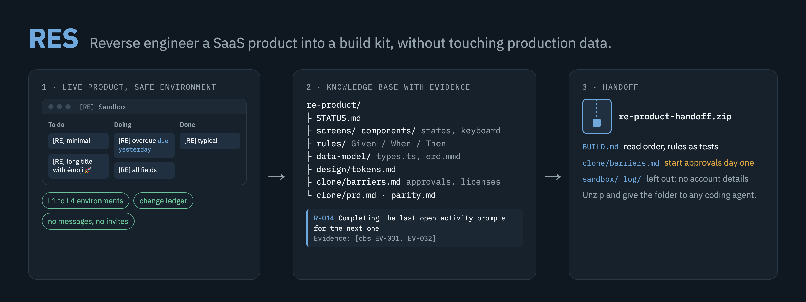
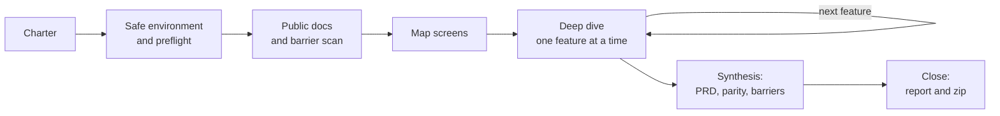

<div align="center">

# RES: Reverse Engineering SaaS

### Turn a SaaS product into a build kit your team or your coding agent can ship.

**Study a web product through the browser, document how it works, and hand off everything needed to rebuild and launch it, without touching production data.**

[](https://github.com/alextnetto/res/actions/workflows/test.yml)
[](https://github.com/alextnetto/res/releases)
[](#quick-start)
[](LICENSE)

[Quick start](#quick-start) · [How RES works](#how-res-works) · [What you get](#what-you-get) · [Examples](#examples) · [Safety model](#safety-model) · [FAQ](#faq) · [Documentation](#documentation)

<code>claude plugin marketplace add alextnetto/res</code>

</div>

> [!IMPORTANT]
> RES drives a real browser on accounts you control. Use it only on products you are allowed to study, read the [safety model](#safety-model) before the first run, and prefer a trial account in a separate browser profile.

<div align="center">



</div>

---

Want to rebuild a product your team relies on, or launch a competitor in your market? Ask your agent to study it with RES. The agent explores the product in a test environment, records every change it makes, and writes what it learns to files: screens and states, business rules with evidence, the data model, API shapes, design tokens, and what could stop the clone from launching, such as integrations that need approval, licenses and certifications.

At the end you get two files. `REPORT.html` is the report you read: one page that starts with the overview and the decisions you need to make, then walks through what the product does, every screen and rule, the data model and design, the build plan, and what to prepare before launch. The zip is for your coding agent: unzip it, give it the folder, and it starts from `BUILD.md`.

RES is one agent skill with plain Markdown templates and a few dependency-free Node.js scripts. It adds about 130 tokens to every session and about 4,600 when it runs (measured with `claude plugin details`).

## Quick start

### Install

In a terminal:

```bash
claude plugin marketplace add alextnetto/res
```

```bash
claude plugin install res@res
```

Inside a Claude Code session, the same commands are `/plugin marketplace add alextnetto/res` and `/plugin install res@res`. Start a new session afterwards.

For other agents that read skills from disk, copy the skill folder where your agent reads skills:

```bash
git clone https://github.com/alextnetto/res.git && mkdir -p ~/.claude/skills && cp -R res/skills/reverse-engineering-saas ~/.claude/skills/
```

You need Node.js 22 or later and an agent that can drive a browser and run JavaScript in the page: Claude in Chrome, Playwright MCP or Chrome DevTools MCP.

### Prepare a safe environment

Create a trial account of the product with an email you own, log in to it in a separate Chrome profile, and connect your agent's browser tool to that profile ([how](skills/reverse-engineering-saas/references/tools.md#separate-profile-for-l1)). This is the safest setup: the agent cannot reach your production account even by mistake.

Without a trial account, the agent writes only if you ask it to test or to create a test environment, and then only inside a separate workspace or a sandbox container. Otherwise it only observes.

### Ask your agent

```text
Study Pipedrive so my team can rebuild it for the Brazilian market.
Use the trial profile, and don't ask me anything until you're done.
```

Replace the product, the market and the scope with your own. The agent creates `re-<product>/` in its working directory, works through the phases below, and sends you `REPORT.html` and `re-<product>-handoff-<date>.zip` when it finishes. To continue later, start a session in the same directory and say "Continue the Pipedrive study."

### Use the scripts directly

The scripts work without an agent, for example to inspect or repackage a knowledge base:

```bash
node skills/reverse-engineering-saas/scripts/init-kb.mjs --product "Acme CRM" --git
```

```bash
node skills/reverse-engineering-saas/scripts/check-kb.mjs re-acme-crm
```

```bash
node skills/reverse-engineering-saas/scripts/build-report.mjs re-acme-crm
```

```bash
node skills/reverse-engineering-saas/scripts/pack-kb.mjs re-acme-crm
```

Each script prints its options with `--help`.

### Update

```bash
claude plugin marketplace update res
```

```bash
claude plugin update res@res
```

## How RES works



| Phase | What happens |
|---|---|
| 1 Charter | Goal, scope, priorities and the clone's target market |
| 2 Environment | Pick the safest environment; check for automations, webhooks and integrations that could fire |
| 3 Recon | Public docs, API reference, pricing, integrations list and terms, read with web fetch; first barrier scan |
| 4 Map | Every screen and route; stack and design tokens |
| 5 Deep dive | One feature at a time: fixtures, states, rules, persistence, network, written to disk before the next feature |
| 6 Synthesis | Data model, design tokens, barriers, PRD, parity tests |
| 7 Close | Restore what changed, pass `check-kb`, send `REPORT.html` and the handoff zip |

The knowledge base on disk is the agent's only memory, so a study can span many sessions and survive context limits. Every statement carries its evidence: `[obs]` seen in the product, `[net]` captured on the network, `[doc]` from public documentation, `[inf]` an inference with an open question.

## What you get

| Area | What the knowledge base contains | Where |
|---|---|---|
| Inventory | Feature tree, screen catalog with URL patterns, a coverage matrix that works as the queue | `inventory/` |
| UX | Anatomy, states (empty, loading, error, no permission, plan-gated), interactions, keyboard, accessibility, microcopy | `screens/`, `components/` |
| Behavior | Business rules as Given/When/Then with evidence, user flows, cross-cutting topics | `rules/`, `flows/`, `topics/` |
| Data | Entities with fields, enums and relations, ER diagram, TypeScript types, permissions matrix | `data-model/` |
| API | Endpoint templates per user action, with JSON shapes and no values | `api/` |
| Design | Color, type, spacing, radius, shadow and motion tokens, mapped to the product's CSS variables | `design/` |
| Production barriers | Integrations that need approval, licenses, certifications, distribution gatekeepers and moats, with severity, market weight, lead time and mitigation | `clone/barriers.md` |
| Build plan | Requirements, parity tests derived from the rules, what to copy, avoid and improve | `clone/` |
| Report | `REPORT.html`: one self-contained page a person reads, with images embedded and every ID linked | KB root |
| Handoff | `BUILD.md`, a brief for any coding agent: read order, rules as tests, what not to copy | zip root |

A rule:

```markdown
### R-014 Completing the last open activity prompts for the next one
- Given a deal with exactly one open activity
- When the user marks that activity done
- Then a "Schedule next activity" dialog opens; Cancel closes it and the deal shows a warning icon
- Evidence: [obs EV-031, EV-032]
```

A production barrier:

```markdown
### BR-003 WhatsApp messages need Meta business verification
- Category: permissioned integration
- Blocks: F-014 (WhatsApp notifications)
- Gatekeeper: Meta, WhatsApp Business Platform
- Severity: blocks feature
- Market weight: required to sell
- Lead time and cost: [doc SRC-021]
- Mitigation: start verification in month one; launch with email notifications
- Evidence: [doc SRC-021]
```

## Examples

Two end-to-end studies, run by Claude Code with Claude in Chrome without a person at the keyboard:

| Product | Environment | Result | Read |
|---|---|---|---|
| ClickUp: board, task view, custom fields | L2, a new free workspace | 55 rules, 19 components, 14 production barriers | [Report](https://alextnetto.github.io/res/examples/clickup/REPORT.html) · [Knowledge base](examples/clickup/) |
| Pipedrive: pipeline, deals, next-activity rule, won and lost | L3, a sandbox pipeline in a production account, removed at the end | 46 rules, 8 components, 15 production barriers | [Report](https://alextnetto.github.io/res/examples/pipedrive/REPORT.html) · [Knowledge base](examples/pipedrive/) |

Each folder is the unzipped handoff. Notes on trademarks and terms: [examples/README.md](examples/README.md).

## Safety model

| Level | Environment | What the agent may change |
|---|---|---|
| L1 | Trial account in a separate browser profile, created by you | Everything except outbound and irreversible actions |
| L2 | New, empty workspace under your login | Test data and configuration inside that workspace |
| L3 | One sandbox list, project or pipeline inside production | Test data inside the container only |
| L4 | Production, observe only | Nothing |

- At every level the agent never sends messages or invites, never assigns or mentions other people, never touches billing, never creates accounts and never types passwords.
- Autosave, read receipts, dismissed banners and persistent view changes count as writes.
- Before every write it checks the location, the audience, the undo path and the ledger.
- Every change goes to `sandbox/ledger.csv`. At the end it is restored, removed, or listed for you to resolve.
- When you ask it not to interrupt you, it writes what needs you under "Needs human" in `STATUS.md` and keeps working on the rest.

The full procedures are in [references/safety.md](skills/reverse-engineering-saas/references/safety.md).

## RES and REA

[REA](https://github.com/morluto/rea) is an open-source reverse engineering toolkit for binaries, Android, Electron, network captures and websites. It answers what a product is built with; RES answers how it works for the user and what it takes to rebuild and launch it. We ran both on ClickUp: [docs/comparison-with-rea.md](docs/comparison-with-rea.md).

## FAQ

<details>
<summary><strong>Will it change my production data?</strong></summary>

Only inside a sandbox you allowed. Every change is recorded in a ledger and, at the end, restored, removed, or listed for you to resolve. Without permission to write, it only observes. Messages, invites, mentions of other people and billing actions are forbidden at every level.

</details>

<details>
<summary><strong>Does it need my password?</strong></summary>

No. The agent never types passwords or creates accounts. You log in, preferably to a trial account in a separate browser profile.

</details>

<details>
<summary><strong>Which agents and browsers work?</strong></summary>

Any agent that reads skills from disk and can drive a browser and run JavaScript in the page. RES was written for Claude Code; the method was tested with Claude Code subagents and the page scripts in headless Chromium. Claude in Chrome, Playwright MCP and Chrome DevTools MCP are covered in [references/tools.md](skills/reverse-engineering-saas/references/tools.md).

</details>

<details>
<summary><strong>Can I leave it running overnight?</strong></summary>

Yes. Tell it not to ask you anything. It records what needs you under "Needs human" in `STATUS.md`, keeps working on the rest, and restores what it changed before it stops.

</details>

<details>
<summary><strong>How do I give the result to my developers?</strong></summary>

Ask for the handoff, or wait for the end of the study. The agent sends `REPORT.html` for people and a zip with the knowledge base and `BUILD.md` for coding agents. Account details (`sandbox/`, `log/`) stay out of the zip, except a copy of the change ledger without object IDs, locations or URLs.

</details>

<details>
<summary><strong>Does it work for desktop or mobile apps?</strong></summary>

Not well. It needs the DOM and the network. For binaries and Electron internals, use [REA](https://github.com/morluto/rea).

</details>

<details>
<summary><strong>Is copying a product legal?</strong></summary>

That depends on the product's terms and your jurisdiction. RES records the relevant terms clause, rebuilds from behavior instead of copying assets, and flags legal questions for counsel. It does not give legal advice.

</details>

## Documentation

- [SKILL.md](skills/reverse-engineering-saas/SKILL.md): the rules the agent follows.
- [Safety](skills/reverse-engineering-saas/references/safety.md): environment setup, preflight, ledger, teardown, incidents.
- [Exploration](skills/reverse-engineering-saas/references/exploration.md): recon, mapping, per-screen checklist, fixtures, rule probing, synthesis.
- [Production barriers](skills/reverse-engineering-saas/references/barriers.md): categories, sources, format.
- [Knowledge base](skills/reverse-engineering-saas/references/knowledge-base.md): layout, IDs, evidence, checks, handoff.
- [Extraction](skills/reverse-engineering-saas/references/extraction.md): page scripts, design tokens, component names, data model, network.
- [Browser tools](skills/reverse-engineering-saas/references/tools.md): Claude in Chrome, Playwright MCP, Chrome DevTools MCP, separate profiles.
- [Design decisions](docs/design.md) and [testing](docs/testing.md): why RES works this way and how it was tested.

## Status

Version 0.4.0. The method was tested with scenario runs on subagents, before and after each change to the skill, and the scripts with automated tests on Node.js 22 and 24. Two end-to-end studies on real products (ClickUp at L2, Pipedrive at L3) are in [examples/](examples/). Version 0.3.0 fixes the gaps the Pipedrive study found; the ClickUp study's are tracked in [an issue](https://github.com/alextnetto/res/issues/5). Reports from real runs are welcome: open a [study report](https://github.com/alextnetto/res/issues/new?template=study_report.yml).

## Responsible use

Use RES only on accounts you own or are authorized to examine. Read the product's terms: many forbid reverse engineering or competing use, and that decision is yours. Rebuild from observed behavior; do not copy code, icons, illustrations, logos or long text. The barrier analysis is research, not legal advice.

## Contributing

See [CONTRIBUTING.md](CONTRIBUTING.md). Security problems go through [SECURITY.md](SECURITY.md).

## License

[MIT](LICENSE)
