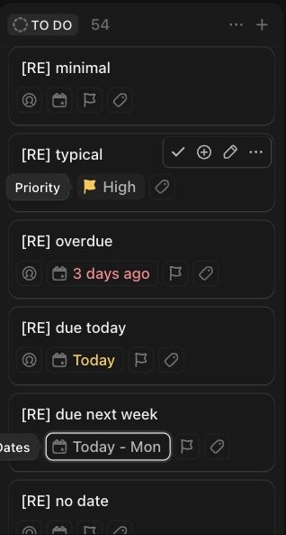

# C-001 Board card
Product name: `cu3-board-task` (`.board-task`) · Used in: S-001 · Status: reviewed

## Anatomy

| # | Part | Content | Evidence |
|---|---|---|---|
| 1 | Cover | Optional image or description above the title (Customize > Card cover: Auto, None, Image, Task description) | [obs EV-021] |
| 2 | Title | Task name, link to `/t/:id/:id`; up to two lines, then ellipsis | [obs EV-012][obs EV-011] |
| 3 | Task properties | Icons for description, attachments, checklists, dependencies (Layout options > Show task properties) | [obs EV-022][doc SRC-009] |
| 4 | Field row | Field toggles in order: assignee, dates, priority, tags, then shown custom fields; empty fields show an outline icon | [obs EV-012][obs EV-043] |
| 5 | Status chip | Only when the board is grouped by a field other than status | [obs EV-026] |
| 6 | Subtasks | "N subtasks" toggle that expands children inside the card | [doc SRC-009] |
| 7 | Hover toolbar | Mark complete, Add subtask, Rename, More; top right, over the title | [obs EV-013] |

Field elements: `cu-assignees-field`, `cu-dates-field` (`cu-task-row-recurring-date-picker`), `cu-priority-field`, `cu-tags-field`, `cu-board-task-custom-fields`, each wrapped in `cu-board-task-field-layout` [obs EV-011].

## Variants

| Variant | Difference | Evidence |
|---|---|---|
| Small / Medium / Large | Column width 200 / 264 / 328 CSS px; card 246 px wide at Medium | [obs EV-046][obs EV-035] |
| Stack fields on | Each filled field on its own row with an icon | [obs EV-023] |
| Show empty fields off | Empty field placeholders hidden; an empty card shows only its title | [obs EV-023] |
| Closed task | Same card in the closed column | [obs EV-012] |

## States

| State | Visual change | Evidence |
|---|---|---|
| Default | Background rgb(25,25,25), radius 10px, hairline white shadow | [obs EV-035] |
| Hover | Hover toolbar appears top right; field tooltips ("Priority", "Dates") | [obs EV-013][obs EV-010] |
| Focus | Field toggle gets a white 1px ring and dark 3px halo; title link no ring | [obs EV-033] |
| Pressed | Not observed | |
| Selected | Checkbox square at top right, filled white | [obs EV-028] |
| Disabled | Not observed | |
| Loading | Skeleton block the size of a card | [obs EV-018] |
| Error | Not observed | |

## Measurements and tokens

| Property | Value | Token | Evidence |
|---|---|---|---|
| Width (Medium) | 246 px inside a 264 px column | | [obs EV-035] |
| Min height | 72 px (title and one field row) | | [obs EV-035] |
| Background | rgb(25,25,25) | --cu-background-subtle | [obs EV-035] |
| Radius | 10px | | [obs EV-035] |
| Shadow | rgba(255,255,255,.333) 0 0 1px, rgba(0,0,0,.055) 0 1px 2px | | [obs EV-035] |
| Title type | 14px/20px, weight 500, rgb(238,238,238) | --cu-content-default | [obs EV-035] |
| Field toggle | 24×24, radius 6px, 1px border rgb(34,34,34) | --cu-border-low-contrast | [obs EV-035] |
| Overdue date text | rgb(255,133,137) | --cu-content-danger | [obs EV-035][obs EV-010] |
| Due today text | rgb(255,204,77) | --cu-content-warning | [obs EV-035][obs EV-010] |

## Behavior

- The whole card opens the task; the title is a real link, so middle click opens a new tab [obs EV-011].
- Each field toggle opens its picker in place (C-004, C-005, C-009, C-010); edits are optimistic [obs EV-006].
- Date chip text is relative: "3 days ago" (red, open and overdue), "Today" (yellow), "Today - Mon" for a range [obs EV-010].
- The hover toolbar overlaps the end of a long title ("[RE] created in colu…") [obs EV-030].

## Keyboard and accessibility

| Role | Accessible name | Keys | Focus visible | Evidence |
|---|---|---|---|---|
| link | task name | Enter opens | no outline | [obs EV-034] |
| button (toolbar) | "Mark complete", "Rename", More named by data-test; Add subtask unnamed | Tab reaches them even without hover | not checked | [obs EV-034] |
| div[tabindex=0] field toggles | none | Tab | yes | [obs EV-033][obs EV-034] |

## Not tested

- Cover image (no attachment fixture), subtasks expander, task property icons with real content, pressed state.
