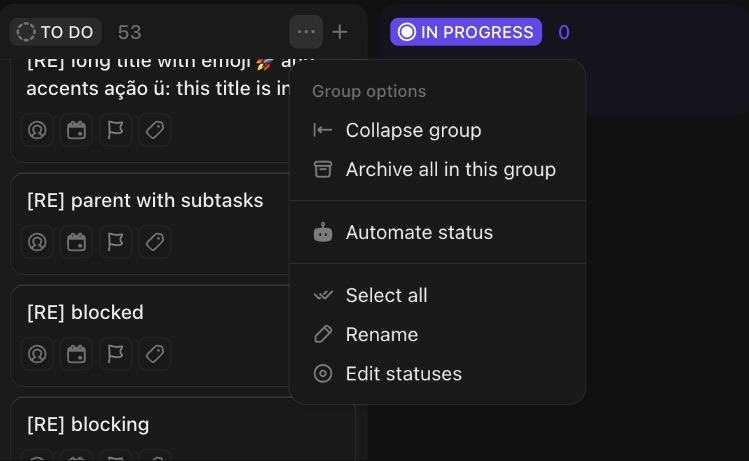

# C-002 Board column
Product name: `cu3-board-group` with `cu3-board-group-header` · Used in: S-001 · Status: reviewed

## Anatomy

| # | Part | Content | Evidence |
|---|---|---|---|
| 1 | Header | Status pill (icon by status type, uppercase name) and count; header background tinted with the status color | [obs EV-012][obs EV-035] |
| 2 | Header hover actions | Collapse (‹), More (Group options), + (add task at the top) | [obs EV-015] |
| 3 | WIP slot | `cu3-board-grouping-header-wip` present in the DOM; limits need Business | [obs EV-011][doc SRC-011] |
| 4 | Card list | Virtualized list (`cdk-virtual-scroll-viewport`) of C-001 | [obs EV-011] |
| 5 | Footer | "+ Add Task" in the status color | [obs EV-012] |

## Variants

| Variant | Difference | Evidence |
|---|---|---|
| Empty | Only "+ Add Task" | [obs EV-002] |
| Collapsed | Vertical strip, rotated name, count | [obs EV-017] |
| Non-status grouping | Header shows the value (flag + "High"); "No priority" column for empty values | [obs EV-026] |
| Swimlane cell | Same column per row of the subgroup | [obs EV-027] |

## States

| State | Visual change | Evidence |
|---|---|---|
| Default | Pill + count | [obs EV-012] |
| Hover | Actions appear on the header | [obs EV-015] |
| Focus | Not checked | |
| Pressed | Not observed | |
| Selected | Not applicable | |
| Disabled | Not observed | |
| Loading | Header skeleton | [obs EV-018] |
| Error | Not observed | |

## Measurements and tokens

| Property | Value | Token | Evidence |
|---|---|---|---|
| Width | 264 px (Medium), 200 (Small), 328 (Large) | | [obs EV-046] |
| Header | 40 px high, 8px padding | | [obs EV-035] |
| Status pill | 20 px high, radius 6px, 11px/500 text, padding 2 6 2 4 | | [obs EV-035] |
| Gap between columns | about 8 px | | [obs EV-012] |

## Behavior

- Group options menu: Collapse group, Archive all in this group, Automate status, Select all, Rename, Edit statuses. Archive all and Select all appear only when the column has tasks (R-009) [obs EV-015][obs EV-016].
- Columns are not draggable on the board [inf] Q-003.

## Keyboard and accessibility

| Role | Accessible name | Keys | Focus visible | Evidence |
|---|---|---|---|---|
| list items (li) per column | status name in data-test only | not checked | not checked | [obs EV-011] |

## Not tested

- Rename, Edit statuses, Automate status and Archive all (not clicked).
