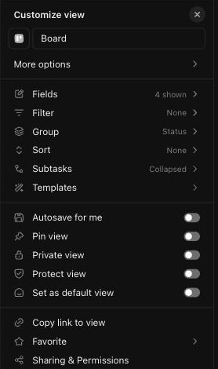

# C-003 Customize view panel
Product name: Customize view side panel (`cu-view-setting-toggle`) · Used in: S-001 · Status: reviewed

## Anatomy

| # | Part | Content | Evidence |
|---|---|---|---|
| 1 | Header | "Customize view", close | [obs EV-019] |
| 2 | Name | View icon and name field ("Board") | [obs EV-019] |
| 3 | More options (inline) | Card size, Card cover, Stack fields, Show empty fields, Collapse empty columns, More options › | [obs EV-020] |
| 4 | Settings list | Fields (n shown), Filter, Group, Sort, Subtasks, Templates | [obs EV-019] |
| 5 | View toggles | Autosave for me, Pin view, Private view, Protect view, Set as default view | [obs EV-019] |
| 6 | Sharing | Copy link to view, Favorite ›, Sharing & Permissions | [obs EV-019] |
| 7 | Layout options page | Page and card layout: Card size, Card cover, Stack fields, Show task properties, Show empty fields, Show task locations, Show subtask parent names, Collapse empty columns, Show column colors. Task visibility: Show closed tasks, Show closed subtasks, Show tasks from other Lists, Show subtasks from other Lists. View settings: Default to Me Mode, Duplicate view, Reset view to defaults, Default view settings | [obs EV-022] |
| 8 | Fields page | Search, Create new / Add existing tabs; Shown (Task Name locked, Assignee, Dates, Priority, Tags); Properties (Date closed, Date created, Date updated, Status, Task ID, Task Type, Time tracked); Custom Fields in Workspace | [obs EV-043][obs EV-044] |

## Variants

| Variant | Difference | Evidence |
|---|---|---|
| Card size dropdown | Small, Medium (default), Large | [obs EV-020] |
| Card cover dropdown | Auto, None, Image (default), Task description | [obs EV-021] |

## States

| State | Visual change | Evidence |
|---|---|---|
| Default | Toggles off except Show empty fields, Show task properties, Show subtask parent names, Show column colors, tasks/subtasks from other Lists | [obs EV-022] |
| Hover | Row highlight; tooltip on Stack fields: "Display standard fields as stacked or inline" | [obs EV-023] |
| Focus | Not checked | |
| Pressed | Not observed | |
| Selected | Checkmark on the chosen dropdown value | [obs EV-020] |
| Disabled | "Show closed tasks" greyed while grouped by status | [obs EV-022] |
| Loading | Not observed | |
| Error | Not observed | |

## Measurements and tokens

| Property | Value | Token | Evidence |
|---|---|---|---|
| Panel width | about 270 px at 1456 px screenshot width (about 320 CSS px) | | [obs EV-019] |
| Toggle on color | brand purple | | [obs EV-022] |

## Behavior

- Every change re-renders the board and shows "Save view"; nothing persists until saved; a reload drops it (R-008) [obs EV-017][net EV-014].
- The Fields page lists workspace fields that the Custom Field Manager does not show (B-008) [obs EV-044][obs EV-045].

## Keyboard and accessibility

| Role | Accessible name | Keys | Focus visible | Evidence |
|---|---|---|---|---|
| toggles | row label (`view-setting-toggle__label`) | not checked | not checked | [obs EV-011] |

## Not tested

- Save view, Autosave, Pin, Private, Protect, Set as default, Duplicate, Reset, Templates, Sharing.
