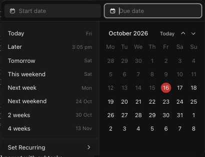

# C-004 Date picker
Product name: `cu-recurring-date-dropdown` · Used in: S-001, S-002 · Status: reviewed

## Anatomy

| # | Part | Content | Evidence |
|---|---|---|---|
| 1 | Inputs | "Start date" and "Due date", each with clear (×) and "Add time" once set | [obs EV-008][obs EV-009] |
| 2 | Quick options | Today, Later (a time later today), Tomorrow, This weekend, Next week (Monday), Next weekend, 2 weeks, 4 weeks; each shows the resolved day | [obs EV-008] |
| 3 | Month grid | Month and year, "Today", previous and next; weeks start on Monday; today in a red circle; range highlighted | [obs EV-009] |
| 4 | Set Recurring › | Recurrence submenu | [obs EV-008] |
| 5 | Work schedule banner | "Set up your work schedule", dismissible | [obs EV-008] |

## Variants

| Variant | Difference | Evidence |
|---|---|---|
| Opens upward | When there is no room below the card | [obs EV-009] |

## States

| State | Visual change | Evidence |
|---|---|---|
| Default | Due date input focused | [obs EV-008] |
| Hover | Quick option row highlight | [obs EV-009] |
| Focus | Focused input has a white border | [obs EV-008] |
| Pressed | Not observed | |
| Selected | Chosen day boxed; start-to-due range shaded | [obs EV-009] |
| Disabled | Not observed | |
| Loading | Not observed | |
| Error | Not observed | |

## Measurements and tokens

| Property | Value | Token | Evidence |
|---|---|---|---|
| Size | about 410 × 310 px (screenshot scale) | | [obs EV-008] |

## Behavior

- Opening it loads the workspace work schedule and schedule exceptions [net EV-014].
- Picking a start date moves focus to the due date input [obs EV-009].
- The value is saved when the picker closes, not when a day is clicked (R-005) [net EV-014].

## Keyboard and accessibility

| Role | Accessible name | Keys | Focus visible | Evidence |
|---|---|---|---|---|
| inputs | placeholders "Start date", "Due date" | Escape closes and saves | yes | [obs EV-008][net EV-014] |

## Not tested

- Typing a date as text, times, recurrence, work schedule setup.
