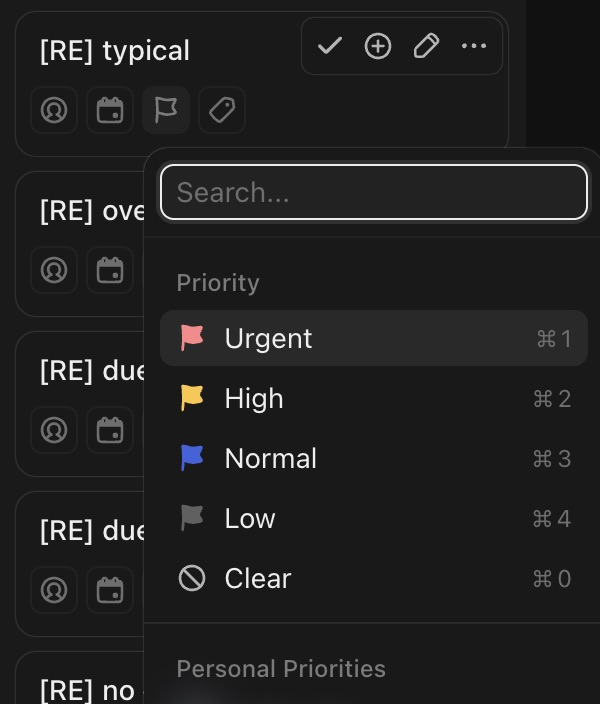

# C-005 Priority picker
Product name: `cu-priority-list-dropdown` · Used in: S-001, S-002 · Status: reviewed

## Anatomy

| # | Part | Content | Evidence |
|---|---|---|---|
| 1 | Search | "Search..." | [obs EV-006] |
| 2 | Priority | Urgent (red flag, ⌘1), High (yellow, ⌘2), Normal (blue, ⌘3), Low (grey, ⌘4), Clear (⌘0) | [obs EV-006] |
| 3 | Personal Priorities | Section with the operator's personal priority list | [obs EV-006] |
| 4 | AI | "Prioritize with AI" | [obs EV-006] |

## Variants

| Variant | Difference | Evidence |
|---|---|---|
| Card chip after choice | Flag in the priority color plus label ("High", "Low") | [obs EV-010][obs EV-032] |

## States

| State | Visual change | Evidence |
|---|---|---|
| Default | First item highlighted | [obs EV-006] |
| Hover | Row highlight | [obs EV-006] |
| Focus | Search focused | [obs EV-006] |
| Pressed | Not observed | |
| Selected | Not observed | |
| Disabled | Not observed | |
| Loading | Not observed | |
| Error | Not observed | |

## Measurements and tokens

| Property | Value | Token | Evidence |
|---|---|---|---|
| Urgent flag | red (rgb 255,133,137 family) | | [obs EV-006] |
| High flag | yellow (rgb 255,204,77 family) | | [obs EV-006] |

## Behavior

- Choosing a value saves at once: `PUT /tasks/v1/item` with `priority` as a numeric string, "2" for High (R-017) [net EV-007].

## Keyboard and accessibility

| Role | Accessible name | Keys | Focus visible | Evidence |
|---|---|---|---|---|
| menu items | priority names | ⌘1 to ⌘4, ⌘0 shown | not checked | [obs EV-006] |

## Not tested

- Keyboard shortcuts themselves, Personal Priorities, Prioritize with AI.
