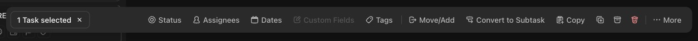

# C-006 Bulk action bar
Product name: bulk action toolbar (`--cu-bulk-action-toolbar-inset-x`) · Used in: S-001 · Status: reviewed

## Anatomy

| # | Part | Content | Evidence |
|---|---|---|---|
| 1 | Count | "1 Task selected" with × to clear | [obs EV-028] |
| 2 | Actions | Status, Assignees, Dates, Custom Fields, Tags, Move/Add, Convert to Subtask, Copy, duplicate, archive, delete (red), More | [obs EV-028] |

## Variants

| Variant | Difference | Evidence |
|---|---|---|
| No custom fields in the list | "Custom Fields" disabled | [obs EV-028] |

## States

| State | Visual change | Evidence |
|---|---|---|
| Default | Floating bar at the bottom center | [obs EV-028] |
| Hover | Not checked | |
| Focus | Not checked | |
| Pressed | Not observed | |
| Selected | Not applicable | |
| Disabled | Greyed action | [obs EV-028] |
| Loading | Not observed | |
| Error | Not observed | |

## Measurements and tokens

| Property | Value | Token | Evidence |
|---|---|---|---|
| Inset | 34px | --cu-bulk-action-toolbar-inset-x | [obs EV-035] |

## Behavior

- Opens after "Select all" in a column menu; selected cards show a filled checkbox at top right [obs EV-028].
- No hover checkbox appeared on cards before a selection existed [obs EV-013].
- × clears the selection and closes the bar [obs EV-028].

## Keyboard and accessibility

| Role | Accessible name | Keys | Focus visible | Evidence |
|---|---|---|---|---|
| buttons | labels as shown; icon-only buttons not checked | not checked | not checked | [obs EV-028] |

## Not tested

- Any bulk action, More menu contents, shift-click range selection.
