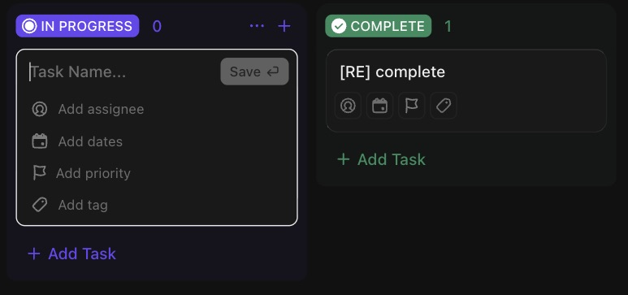

# C-007 Inline task create form
Product name: board quick create card · Used in: S-001 · Status: reviewed

## Anatomy

| # | Part | Content | Evidence |
|---|---|---|---|
| 1 | Name input | Placeholder "Task Name..." | [obs EV-029] |
| 2 | Save | "Save ↵", disabled while the name is empty | [obs EV-029] |
| 3 | Field shortcuts | Add assignee, Add dates, Add priority, Add tag | [obs EV-029] |

## Variants

| Variant | Difference | Evidence |
|---|---|---|
| Column footer "+ Add Task" | Form opens at the end of the column | [obs EV-029] |
| Header + | Form opens at the top of the column | [obs EV-015] |

## States

| State | Visual change | Evidence |
|---|---|---|
| Default | White border around the form | [obs EV-029] |
| Hover | Not checked | |
| Focus | Input focused on open | [obs EV-029] |
| Pressed | Not observed | |
| Selected | Not applicable | |
| Disabled | Save disabled when empty | [obs EV-029] |
| Loading | Not observed | |
| Error | Not observed | |

## Measurements and tokens

| Property | Value | Token | Evidence |
|---|---|---|---|
| Width | card width | | [obs EV-029] |

## Behavior

- Enter with an empty name does nothing and shows no message [obs EV-029].
- Enter with a name creates the task with the column's status, keeps the form open for the next task and shows a "Task created" toast (R-010) [obs EV-030].

## Keyboard and accessibility

| Role | Accessible name | Keys | Focus visible | Evidence |
|---|---|---|---|---|
| textbox | placeholder only | Enter saves, Escape closes | yes | [obs EV-029] |

## Not tested

- Field shortcuts inside the form, pasting several lines.
