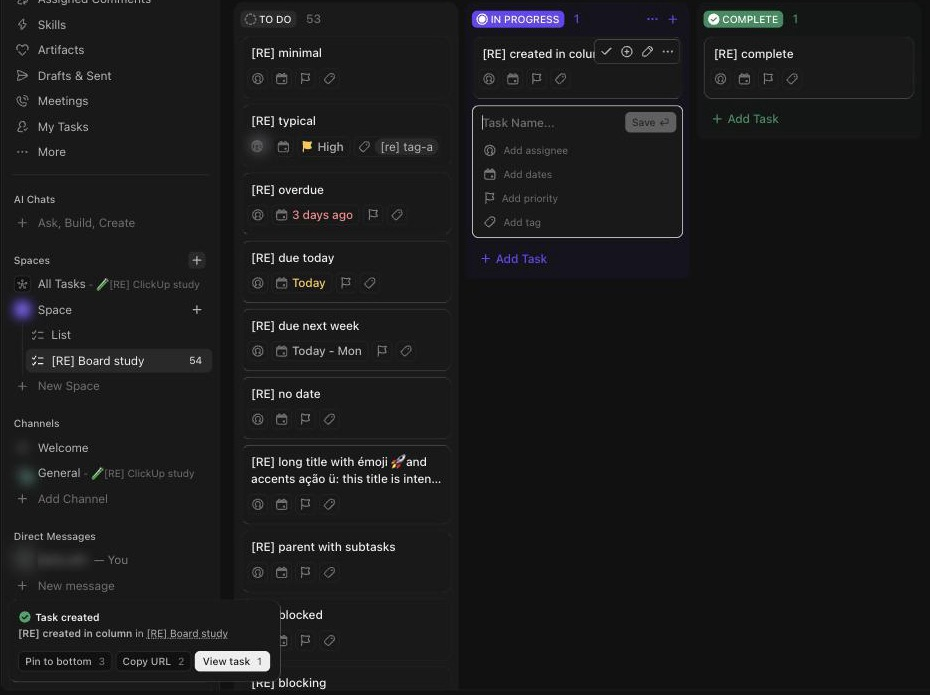

# C-008 Toast
Product name: `cu-toast-new` · Used in: S-001, S-002 · Status: reviewed

## Anatomy

| # | Part | Content | Evidence |
|---|---|---|---|
| 1 | Icon and title | Green check and "Task created", or "Status changed" | [obs EV-030][obs EV-012] |
| 2 | Body | Task name "in" list link | [obs EV-030] |
| 3 | Actions | Buttons with a number or key hint: "Pin to bottom 3", "Copy URL 2", "View task 1"; "Undo ⌘Z" | [obs EV-030][obs EV-012] |

## Variants

| Variant | Difference | Evidence |
|---|---|---|
| Task created | Three actions with digit shortcuts | [obs EV-030] |
| Status changed | Undo with ⌘Z | [obs EV-012] |
| Priorities prompt | "Don't ask again ⌥1", "Add to priorities ⌥2" | [obs EV-042] |
| Offline mode | "You can still track time and create tasks and reminders! Access any task in your tray." | [obs EV-019] |

## States

| State | Visual change | Evidence |
|---|---|---|
| Default | Bottom left over the sidebar, stacked when several | [obs EV-030] |
| Hover | Not checked | |
| Focus | Not checked | |
| Pressed | Not observed | |
| Selected | Not applicable | |
| Disabled | Not observed | |
| Loading | Not observed | |
| Error | Not observed | |

## Measurements and tokens

| Property | Value | Token | Evidence |
|---|---|---|---|
| Width | about 270 px at screenshot scale | | [obs EV-030] |

## Behavior

- Several toasts stack; each disappears after a few seconds [obs EV-030].

## Keyboard and accessibility

| Role | Accessible name | Keys | Focus visible | Evidence |
|---|---|---|---|---|
| buttons | labels | digit and ⌘Z hints shown; not pressed | not checked | [obs EV-030] |

## Not tested

- The digit shortcuts and Undo itself; the exact timeout.
