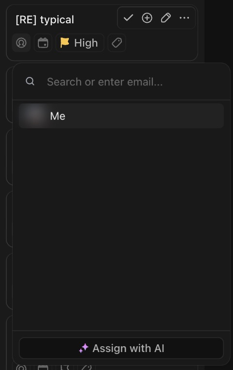

# C-009 Assignee picker
Product name: `cu-user-list-dropdown` · Used in: S-001, S-002 · Status: reviewed

## Anatomy

| # | Part | Content | Evidence |
|---|---|---|---|
| 1 | Search | "Search or enter email..." | [obs EV-041] |
| 2 | People | "Me" first (avatar), then members | [obs EV-041] |
| 3 | AI | "Assign with AI" | [obs EV-041] |

## Variants

| Variant | Difference | Evidence |
|---|---|---|
| Single-member workspace | Only "Me" | [obs EV-041] |

## States

| State | Visual change | Evidence |
|---|---|---|
| Default | List of people | [obs EV-041] |
| Hover | Row highlight | [obs EV-041] |
| Focus | Not checked | |
| Pressed | Not observed | |
| Selected | Avatar shown on the card | [obs EV-012] |
| Disabled | Not observed | |
| Loading | Not observed | |
| Error | Not observed | |

## Measurements and tokens

| Property | Value | Token | Evidence |
|---|---|---|---|
| Width | about 240 px at screenshot scale | | [obs EV-041] |

## Behavior

- Picking "Me" saves at once (`PUT /tasks/v1/task/:id` with `assignees.add`) and then shows a prompt to add the task to the user's priorities (R-007) [net EV-014][obs EV-042].
- Typing an email would invite a person (A5): not done.

## Keyboard and accessibility

| Role | Accessible name | Keys | Focus visible | Evidence |
|---|---|---|---|---|
| list | not checked | not checked | not checked | |

## Not tested

- Teams, other members, invite by email (needs a second account: L1).
