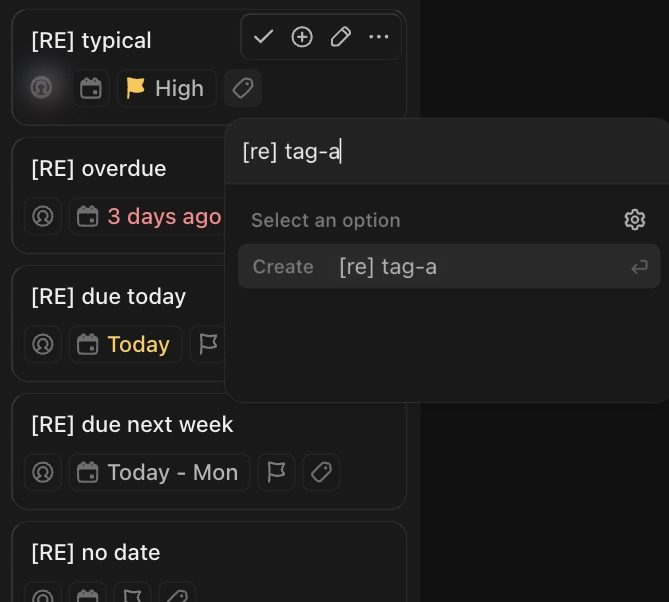

# C-010 Tag picker
Product name: `cu-tags-list` · Used in: S-001, S-002 · Status: reviewed

## Anatomy

| # | Part | Content | Evidence |
|---|---|---|---|
| 1 | Input | Tag search; applied tags show as removable pills inside it | [obs EV-040] |
| 2 | Options | "Select an option" header, matching tags, "Create <name> ↵" when no tag matches | [obs EV-040] |
| 3 | Settings | Gear to manage tags | [obs EV-040] |

## Variants

| Variant | Difference | Evidence |
|---|---|---|
| Card chip | Grey pill with the tag name ("[re] tag-a") | [obs EV-012] |

## States

| State | Visual change | Evidence |
|---|---|---|
| Default | Input focused | [obs EV-040] |
| Hover | Not checked | |
| Focus | Not checked | |
| Pressed | Not observed | |
| Selected | Pill in the input | [obs EV-040] |
| Disabled | Not observed | |
| Loading | Not observed | |
| Error | Not observed | |

## Measurements and tokens

| Property | Value | Token | Evidence |
|---|---|---|---|
| New tag colors | tag_fg and tag_bg hex colors chosen by the product | | [net EV-014] |

## Behavior

- Tags are created at Space level and applied to the task in one request when the picker closes (R-006) [net EV-014].

## Keyboard and accessibility

| Role | Accessible name | Keys | Focus visible | Evidence |
|---|---|---|---|---|
| input | not checked | Enter creates | not checked | [obs EV-040] |

## Not tested

- Tag colors, tag manager, removing a tag.
