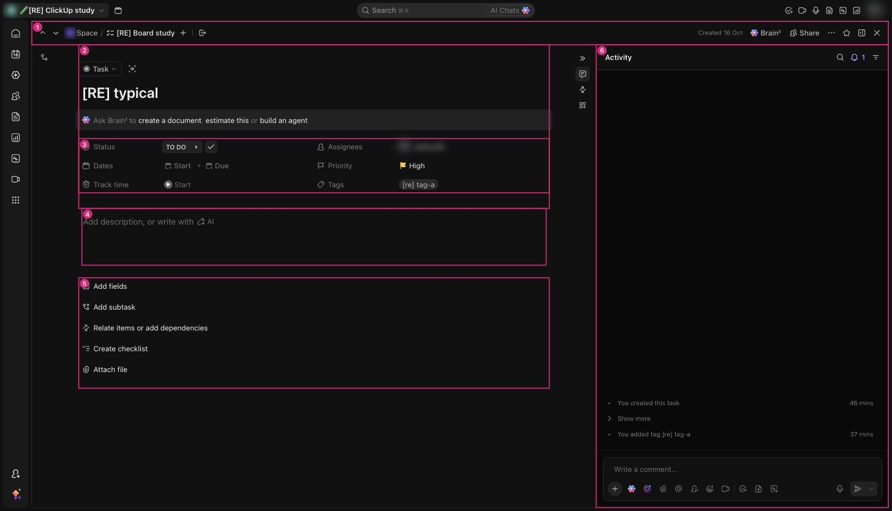

# C-011 Task fields grid
Product name: `cu-task-fields-container` · Used in: S-002 · Status: reviewed

## Anatomy

| # | Part | Content | Evidence |
|---|---|---|---|
| 1 | Status | Status pill, next-status arrow ▸, complete ✓ | [obs EV-073] |
| 2 | Dates | Start → Due; overdue due date in red | [obs EV-059] |
| 3 | Track time | Start timer | [obs EV-051] |
| 4 | Assignees | Avatars; Empty when none | [obs EV-051] |
| 5 | Priority | Flag and label; Empty when none | [obs EV-051] |
| 6 | Tags | Tag pills; Empty when none | [obs EV-051] |
| 7 | Dependency rows | Blocked by / Blocking with the other task | [obs EV-065][obs EV-066] |
| 8 | Collapse empty fields | Link that hides empty properties | [obs EV-073] |

## Variants

| Variant | Difference | Evidence |
|---|---|---|
| Empty task | Placeholders Start, Due, Empty | [obs EV-059] |
| With dependency | Extra row under the grid | [obs EV-065] |

## States

| State | Visual change | Evidence |
|---|---|---|
| Default | Label column with icons, value column | [obs EV-051] |
| Hover | Not checked |  |
| Focus | Not checked |  |
| Pressed | Not observed |  |
| Selected | Not applicable |  |
| Disabled | Not observed |  |
| Loading | Not observed |  |
| Error | Not observed |  |

## Measurements and tokens

| Property | Value | Token | Evidence |
|---|---|---|---|
| Layout | two columns of label + value |  | [obs EV-051] |

## Behavior

- Each value opens the same pickers as the board card (C-004, C-005, C-009, C-010) [obs EV-051].
- The ✓ completes the task; ▸ moves to the next status (R-024) [obs EV-073].
- A browser-stored preference hides empty fields (`cu-task-view-hide-empty-location-fields` in localStorage) [obs EV-011].

## Keyboard and accessibility

| Role | Accessible name | Keys | Focus visible | Evidence |
|---|---|---|---|---|
| buttons | label icons per field (`task-field-label-icon__container-<Field>`) | not checked | not checked | [obs EV-050] |

## Not tested

- Time tracking, Collapse empty fields toggle (browser preference), assignee change in the task view.
