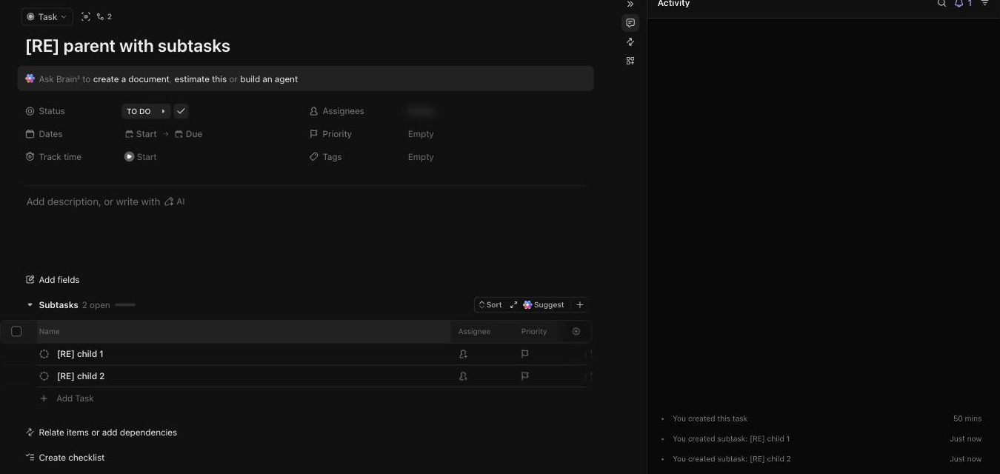

# C-013 Subtasks section
Product name: `cu-task-view-subtasks-section` · Used in: S-002 · Status: reviewed

## Anatomy

| # | Part | Content | Evidence |
|---|---|---|---|
| 1 | Header | Subtasks, N open, progress bar; Sort, expand, Suggest (AI), + | [obs EV-062] |
| 2 | Table | Name with status circle, Assignee, Priority, add column | [obs EV-062] |
| 3 | Add Task row | Inline create | [obs EV-062] |

## Variants

| Variant | Difference | Evidence |
|---|---|---|
| Before first subtask | Single input under the header | [obs EV-061] |

## States

| State | Visual change | Evidence |
|---|---|---|
| Default | Table | [obs EV-062] |
| Hover | Not checked |  |
| Focus | Input focused after Add subtask | [obs EV-061] |
| Pressed | Not observed |  |
| Selected | Row checkbox column | [obs EV-062] |
| Disabled | Not observed |  |
| Loading | Not observed |  |
| Error | Not observed |  |

## Measurements and tokens

| Property | Value | Token | Evidence |
|---|---|---|---|
| Row height | about 30 px |  | [obs EV-062] |

## Behavior

- Enter creates the subtask and keeps the input open; each create is one request with `parent` set (R-028) [net EV-063].

## Keyboard and accessibility

| Role | Accessible name | Keys | Focus visible | Evidence |
|---|---|---|---|---|
| table rows | not checked | Enter creates | not checked | [obs EV-061] |

## Not tested

- Sort, Suggest (AI), nested subtasks, subtask status changes, converting a subtask.
