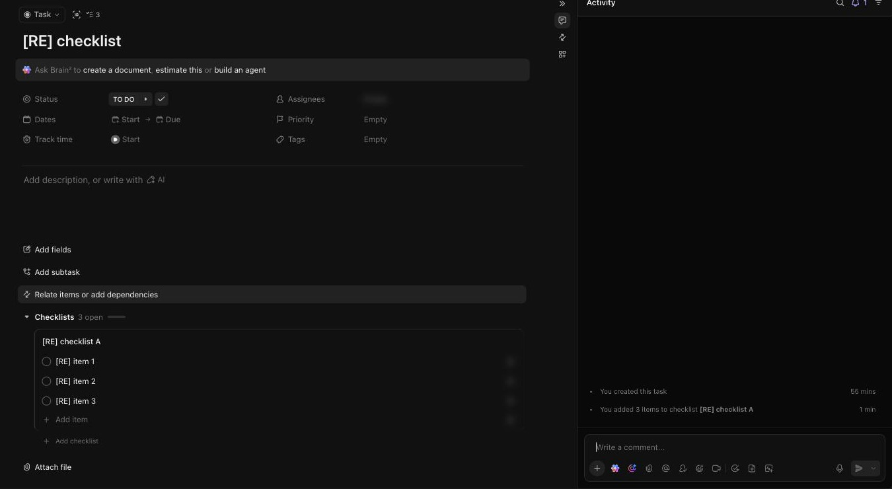

# C-014 Checklist
Product name: `cu-task-view-checklists-section` · Used in: S-002 · Status: reviewed

## Anatomy

| # | Part | Content | Evidence |
|---|---|---|---|
| 1 | Header | Checklists, N open, progress bar; expand, + | [obs EV-071] |
| 2 | Checklist | Editable name, items with circles, Add item | [obs EV-071] |
| 3 | Footer | Show N completed, Add checklist | [obs EV-072] |
| 4 | Item hover | Drag handle; actions (assign, convert, More) | [obs EV-072] |

## Variants

| Variant | Difference | Evidence |
|---|---|---|
| New | Name 'Checklist' in edit mode | [obs EV-067] |

## States

| State | Visual change | Evidence |
|---|---|---|
| Default | Open items listed | [obs EV-071] |
| Hover | Item actions | [obs EV-072] |
| Focus | Not checked |  |
| Pressed | Not observed |  |
| Selected | Resolved items hidden | [obs EV-072] |
| Disabled | Not observed |  |
| Loading | Skeleton while created | [obs EV-067] |
| Error | Not observed |  |

## Measurements and tokens

| Property | Value | Token | Evidence |
|---|---|---|---|
| Item row | about 30 px |  | [obs EV-071] |

## Behavior

- Create checklist saves an empty checklist at once (R-030); items save one request each; items have uuid IDs and can nest (`children`) and carry an assignee and dates [net EV-069].
- Resolved items collapse under Show completed (R-031) [obs EV-072].

## Keyboard and accessibility

| Role | Accessible name | Keys | Focus visible | Evidence |
|---|---|---|---|---|
| items | not checked | Enter adds, Escape on empty closes the task view | not checked | [obs EV-068] |

## Not tested

- Item assignee and dates, nesting, reordering, deleting a checklist, converting an item to a task.
