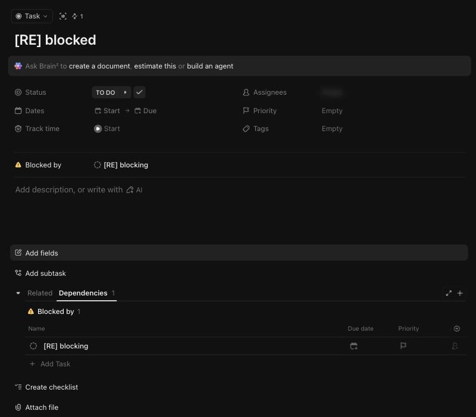

# C-015 Relationships section
Product name: `cu-task-view-relationships-section` · Used in: S-002 · Status: reviewed

## Anatomy

| # | Part | Content | Evidence |
|---|---|---|---|
| 1 | Tabs | Related, Dependencies with count | [obs EV-065] |
| 2 | Dependencies table | Group Blocked by N; Name, Due date, Priority, assignee | [obs EV-065] |
| 3 | Related empty state | No tasks or docs related. Relate | [obs EV-066] |

## Variants

| Variant | Difference | Evidence |
|---|---|---|
| Blocked side | Warning icon, Blocked by | [obs EV-065] |
| Blocking side | Red icon, Blocking | [obs EV-066] |

## States

| State | Visual change | Evidence |
|---|---|---|
| Default | Tabs and table | [obs EV-065] |
| Hover | Not checked |  |
| Focus | Not checked |  |
| Pressed | Not observed |  |
| Selected | Active tab underlined | [obs EV-065] |
| Disabled | Not observed |  |
| Loading | Not observed |  |
| Error | Not observed |  |

## Measurements and tokens

| Property | Value | Token | Evidence |
|---|---|---|---|
| Tab | underline indicator |  | [obs EV-065] |

## Behavior

- The Relate menu offers Relate a Task or Doc, This task blocks..., This task is blocked by..., New custom relationship [obs EV-064].
- Picking a task from search creates the dependency in one request (`task_id`, `depends_on`; the response has `type` and `lag_ms`) (R-029) [net EV-069].

## Keyboard and accessibility

| Role | Accessible name | Keys | Focus visible | Evidence |
|---|---|---|---|---|
| tabs (role tab) | Related, Dependencies | not checked | not checked | [obs EV-050] |

## Not tested

- Plain task links, custom relationships, removing a dependency, closing a blocked task (dependency warning).
