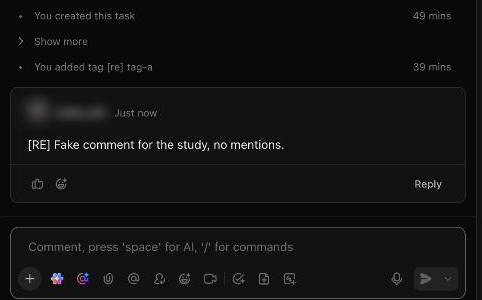

# C-016 Activity and comments
Product name: `cu-task-view-right-sidebar` · Used in: S-002 · Status: reviewed

## Anatomy

| # | Part | Content | Evidence |
|---|---|---|---|
| 1 | Header | Activity, search, follower count, filter | [obs EV-051] |
| 2 | History lines | You <did> … with relative time; Show more folds older lines | [obs EV-051][obs EV-073] |
| 3 | Comment card | Author, time, text, reactions, Reply | [obs EV-057] |
| 4 | Composer | Text, toolbar (add, AI, attach, mention, assign, emoji, clip, task, doc), send with menu | [obs EV-056] |

## Variants

| Variant | Difference | Evidence |
|---|---|---|
| Modal layout | Sidebar inside the modal | [obs EV-075] |
| Sidebar layout | Collapsed to icons | [obs EV-074] |

## States

| State | Visual change | Evidence |
|---|---|---|
| Default | History only | [obs EV-051] |
| Hover | Not checked |  |
| Focus | Composer focused | [obs EV-056] |
| Pressed | Not observed |  |
| Selected | Not applicable |  |
| Disabled | Send disabled while empty | [obs EV-051] |
| Loading | Empty list until history loads | [obs EV-051] |
| Error | Not observed |  |

## Measurements and tokens

| Property | Value | Token | Evidence |
|---|---|---|---|
| Width | about 560 CSS px |  | [obs EV-050] |

## Behavior

- History is read in pages from `tasks/history`; comments come from a separate comment service [net EV-053][net EV-058].
- Several item creations aggregate into one line ("added 3 items") [obs EV-071].

## Keyboard and accessibility

| Role | Accessible name | Keys | Focus visible | Evidence |
|---|---|---|---|---|
| textbox | placeholder only | not checked | not checked | [obs EV-056] |

## Not tested

- Mentions, assigned comments, threads, reactions, attachments in comments, activity filters and search.
