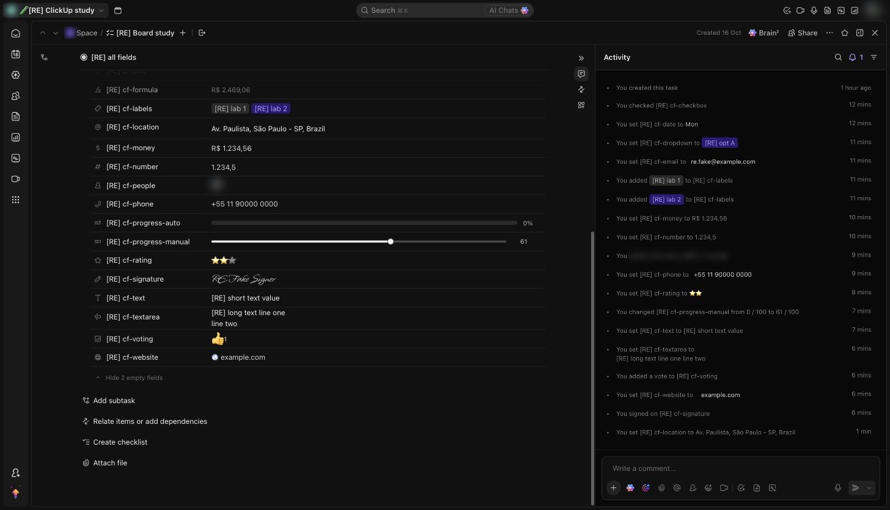

# C-017 Task Fields section
Product name: `cu-task-view-custom-fields-section` · Used in: S-002 · Status: reviewed

## Anatomy

| # | Part | Content | Evidence |
|---|---|---|---|
| 1 | Header | Collapse arrow, "Fields", then search, expand and + (add field) | [obs EV-117] |
| 2 | Row label | Type icon and field name; on hover a pin-off icon at the left and a gear (field settings) at the right | [obs EV-102][obs EV-117] |
| 3 | Row value | The value as rendered by its type (C-019), "–" when empty; on hover a clear × at the far right | [obs EV-103][obs EV-117] |
| 4 | Footer | "Hide N empty fields" / show toggle | [obs EV-117] |
| 5 | Add fields popover (from +) | Search for new or existing fields, tabs Create new and Add existing, Popular and All type lists | [obs EV-079] |

## Variants

| Variant | Difference | Evidence |
|---|---|---|
| All filled | No empty rows; the footer counts only the empty ones left | [obs EV-117] |
| Mostly empty | Rows show "–"; empty rows stay listed until hidden with the footer link | [obs EV-100] |

## States

| State | Visual change | Evidence |
|---|---|---|
| Default | Label column and value column, one row per field | [obs EV-117] |
| Hover | Row highlight, gear and clear icons | [obs EV-102] |
| Focus | The value becomes an input or opens a picker or popover | [obs EV-102][obs EV-108] |
| Pressed | Not observed | |
| Selected | Not applicable | |
| Disabled | Formula values are grey and read-only | [obs EV-116] |
| Loading | Formula showed empty for a moment after the task opened | [obs EV-129] |
| Error | Not observed | |

## Measurements and tokens

| Property | Value | Token | Evidence |
|---|---|---|---|
| Layout | two columns, label about one quarter of the width | | [obs EV-117] |
| Row height | about 30 screenshot px; text area rows grow with the lines | | [obs EV-117] |

## Behavior

- Rows are sorted by name and include every field of the task's locations; Tasks and Relationship fields are not here, they live in the Related section (R-039, R-043) [obs EV-117][obs EV-118].
- Every value saves on its own; there is no Save button (R-044) [net EV-112].
- The gear opens the field settings popover (C-018) for that field, from which the field can be deleted (R-051) [obs EV-125].
- Escape inside the task view closes the whole view (R-032), so editors are closed by clicking outside [obs EV-068].

## Keyboard and accessibility

| Role | Accessible name | Keys | Focus visible | Evidence |
|---|---|---|---|---|
| button | "Set value for <field> Custom Field" | not checked | not checked | [obs EV-139] |

## Not tested

- Keyboard entry into rows, the search and expand icons, drag order, Add existing.
- How required, pinned and task-type fields are grouped (plan-gated).
