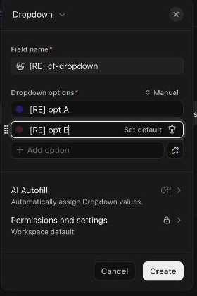

# C-018 Custom field form
Product name: field create and edit popover · Used in: S-002, S-003 · Status: reviewed

## Anatomy

| # | Part | Content | Evidence |
|---|---|---|---|
| 1 | Type switcher | Current type with a menu to change it; "Advanced" (gear) on edit | [obs EV-080][obs EV-125] |
| 2 | Field name | Required; emoji picker at the left | [obs EV-080][obs EV-125] |
| 3 | Type options | Per type, see the table below | [obs EV-084] to [obs EV-094] |
| 4 | AI Autofill | "Automatically assign Dropdown values", Off by default | [obs EV-080][obs EV-125] |
| 5 | Permissions and settings | Description, Permissions (Workspace default), Exceptions (creator can edit), Required in tasks, Pinned, Visible to Guests and Limited Members (on), "Belongs to" with the location | [obs EV-081] |
| 6 | Footer | Create or Save (disabled until valid), Cancel; on edit a red delete icon at the left | [obs EV-080][obs EV-125] |

## Options per type

| Type | Options in the form | Evidence |
|---|---|---|
| Dropdown | Options with color dots, Set default, delete per option, Add option, AI option generator, sort Manual | [obs EV-080][obs EV-125] |
| Labels | Same as Dropdown; Create stays disabled until one option exists | [obs EV-092] |
| Number | Number format US (1,234.56) or EU (1.234,56) | [obs EV-084] |
| Money | Currency (BRL - Brazilian Real (R$) chosen), number format | [obs EV-085] |
| Voting | Emoji type, "Hide users who have voted" | [obs EV-086] |
| Tasks | Relationship name, related to any task in the workspace or to tasks from one List, Create rollup fields | [obs EV-087] |
| Relationship | Tasks from a specific List (required; the field's own list not offered), rollup fields from it | [obs EV-093] |
| People | Show people from the entire workspace, show guests, select multiple people (on), include teams | [obs EV-088] |
| Rating | Emoji type (star), scale 1 to 5 (default 3) | [obs EV-089] |
| Progress (Auto) | Track completion of subtasks, checklists, assigned comments; tasks without action items show 100% when done | [obs EV-090] |
| Progress (Manual) | Start value 0, end value 100 | [obs EV-091] |
| Button | Name, button label and color; "Action required: Add automation" | [obs EV-094] |
| AI Summary | A Text area preset with AI Autofill on and a prompt | [obs EV-095] |

## Variants

| Variant | Difference | Evidence |
|---|---|---|
| Create from a task | Opens over the task; location defaults to the task's list | [obs EV-080][obs EV-081] |
| Create from the manager | Opens over the manager after choosing a type | [obs EV-086] |
| Edit from the row gear | Same form with Save, Advanced and the delete icon | [obs EV-125] |

## States

| State | Visual change | Evidence |
|---|---|---|
| Default | Footer button disabled until required parts are filled | [obs EV-092][obs EV-125] |
| Hover | Not checked | |
| Focus | Name input focused on open | [obs EV-080] |
| Pressed | Not observed | |
| Selected | Not applicable | |
| Disabled | Required in tasks cannot be turned on (Free Forever) | [obs EV-082] |
| Loading | Not observed | |
| Error | Not observed | |

## Measurements and tokens

| Property | Value | Token | Evidence |
|---|---|---|---|
| Width | about 310 screenshot px popover | | [obs EV-125] |

## Behavior

- Create sends the definition and then its location (R-033) [net EV-099].
- Required in tasks does not turn on and Pinned opens an upgrade dialog on Free Forever (R-041) [obs EV-082][obs EV-083].
- The delete icon asks for confirmation and moves the field to Trash (R-051) [obs EV-126].

## Keyboard and accessibility

| Role | Accessible name | Keys | Focus visible | Evidence |
|---|---|---|---|---|
| dialog | not checked | not checked | not checked | |

## Not tested

- Changing the type of an existing field (conversion rules are in SRC-045), Advanced settings, default values, permissions and exceptions with other people (needs L1).
- AI option generator and AI Autofill (consume AI credits).
- Button fields with an automation, Rollup fields.
