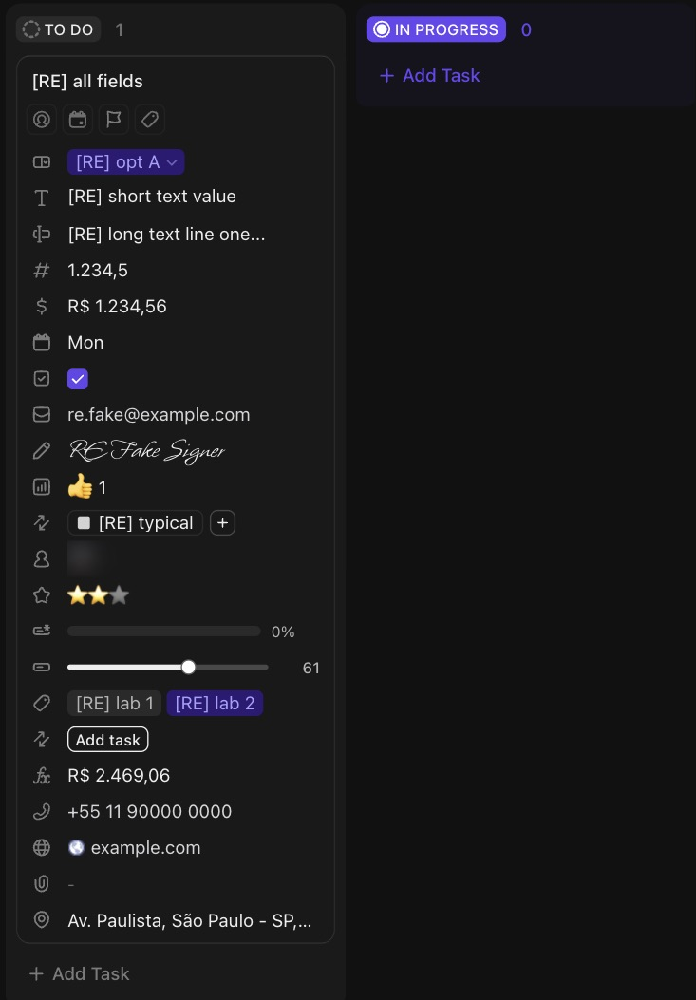

# C-019 Custom field value, by type
Product name: value cell in the Fields section and the card field row · Used in: S-001, S-002 · Status: reviewed

How each of the 22 field types tested looks in the task view and on a board card, how it is edited and what it stores. Request shapes are in EV-112.

## Anatomy

| # | Part | Content | Evidence |
|---|---|---|---|
| 1 | Type icon | One icon per type, at the left of the task row and of the card row | [obs EV-117][obs EV-121] |
| 2 | Value | Rendered per type (table below) | [obs EV-117][obs EV-121] |
| 3 | Empty value | "–" in the task view, "-" on cards, with the exceptions in the table | [obs EV-100][obs EV-120] |

## Rendering per type

| Type | Task view, filled | Editor | Card, empty | Card, filled | Stored value | Evidence |
|---|---|---|---|---|---|---|
| Checkbox | Purple checked box | Click | Empty box | Checked box | boolean | [obs EV-117][obs EV-120][obs EV-121][net EV-112] |
| Date | Relative day ("Mon") | Date picker | - | "Mon" | epoch ms + time flag | [obs EV-117][obs EV-121][net EV-112] |
| Dropdown | Colored pill with ▾ | Picker: search, colored options, drag handles | - | Pill with ▾, editable in place | option id | [obs EV-100][obs EV-122][net EV-112] |
| Labels | Colored pills | Same picker, several values | - | Pills | one add per label | [obs EV-101][obs EV-121][net EV-112] |
| Text | Plain text | Inline input | - | Text | string | [obs EV-111][obs EV-121] |
| Text area | Several lines | Large popover editor | - | First line + "..." | string, rich text copy | [obs EV-108][obs EV-109][obs EV-121][net EV-112] |
| Number | 1.234,5 (field format EU) | Inline input with clear × | - | 1.234,5 | string | [obs EV-103][obs EV-121][net EV-112] |
| Money | R$ 1.234,56 (BRL, EU); empty shows "R$" | Inline input with mask | - | R$ 1.234,56 | string | [obs EV-101][obs EV-102][obs EV-121] |
| Email | Text | Inline input | - | Text | string (email) | [obs EV-117][obs EV-121] |
| Phone | +55 11 90000 0000 | Flag menu + masked input; the flag writes the profile country (R-036) | - | Same text, shown a moment later | string | [obs EV-104][obs EV-105][obs EV-121] |
| Website | Favicon + domain only | Inline input | - | Favicon + domain | string (url) | [obs EV-111][obs EV-121] |
| Location | Formatted address | Search with Google Places suggestions | - | Address cut at card width | address, lat, lng, place id | [obs EV-113][obs EV-114][obs EV-121][net EV-112] |
| People | Avatar (masked) | Person picker, "Keep typing a full email to invite" | - | Avatar | user ids add/rem | [obs EV-106][obs EV-121][net EV-112] |
| Rating | 2 of 3 stars | Click a star | Grey stars | Stars, shown a moment later | number | [obs EV-111][obs EV-120][obs EV-121] |
| Voting | 👍 1 | Toggle own vote | 👍 0 | 👍 1 | user ids add/rem | [obs EV-109][obs EV-120][obs EV-121][net EV-112] |
| Progress (Manual) | Slider with value 61 | Drag the knob | Slider at 0 | Slider and 61 | `{current}` | [obs EV-107][obs EV-120][obs EV-121][net EV-112] |
| Progress (Auto) | Bar 0% | Computed (subtasks, checklists, assigned comments) | Bar 0%; 100% on a closed task | Bar and percent | computed | [obs EV-090][obs EV-120] |
| Signature | Typed name in a script font | Pad, Type or Draw, Clear, Save | - | Script name | string + isTyped, signedBy | [obs EV-110][obs EV-111][obs EV-121][net EV-112] |
| Formula | Grey computed value, R$ 2.469,06 | Field, operator, field; Advanced Editor | R$ 0 | R$ 2.469,06 | definition only (no per-task write) | [obs EV-115][obs EV-116][obs EV-120][net EV-112] |
| Files | "–" | Not tested (upload) | - | - | not captured | [obs EV-121] |
| Tasks | Not in Fields; Related tab with a table | Relate menu > field > task picker (Recent Tasks) | "Add task" | Task chip + "+" | task ids add/rem | [obs EV-118][obs EV-119][obs EV-121][net EV-112] |
| Relationship | Not in Fields; Related tab | Relate menu > field | "Add task" | "Add task" (target list empty) | not captured | [obs EV-118][obs EV-121] |

## Variants

| Variant | Difference | Evidence |
|---|---|---|
| Task view | Full value, editor in place or in a popover | [obs EV-117] |
| Card | One row per shown field, compact, cut to the card width | [obs EV-121] |

## States

| State | Visual change | Evidence |
|---|---|---|
| Default | As in the table | [obs EV-117] |
| Hover | Card: field name tooltip on the icon; task view: gear and clear icons | [obs EV-122][obs EV-102] |
| Focus | Editor opens | [obs EV-102] |
| Pressed | Not observed | |
| Selected | Not applicable | |
| Disabled | Formula is read-only | [obs EV-116] |
| Loading | Rating and phone appear on cards after the other rows | [obs EV-121] |
| Error | Not observed (no invalid email or URL tried) | |

## Measurements and tokens

| Property | Value | Token | Evidence |
|---|---|---|---|
| Card row | icon column plus value, about 24 screenshot px per row | | [obs EV-121] |

## Behavior

- Values render the same way in the task and on the card, except text area (first line on the card), location (cut) and the relationship types (chips on the card, a Related tab in the task) [obs EV-117][obs EV-121].
- Number and money formats come from the field, not from the user's language (R-035) [obs EV-084][obs EV-085].

## Keyboard and accessibility

| Role | Accessible name | Keys | Focus visible | Evidence |
|---|---|---|---|---|
| button | "Set value for <field> Custom Field" | not checked | not checked | [obs EV-139] |

## Not tested

- Files (upload), Button (needs an automation), Rollup, AI fields (Summary, Custom Text, Custom Dropdown, Categorize, Translation, Sentiment, Action Items, T-shirt Size; they spend AI credits).
- Invalid input (bad email, bad URL, letters in Number), very long values, many labels or people on a card.
- Drawn signatures, Relationship with linked tasks, Voting by several people.
