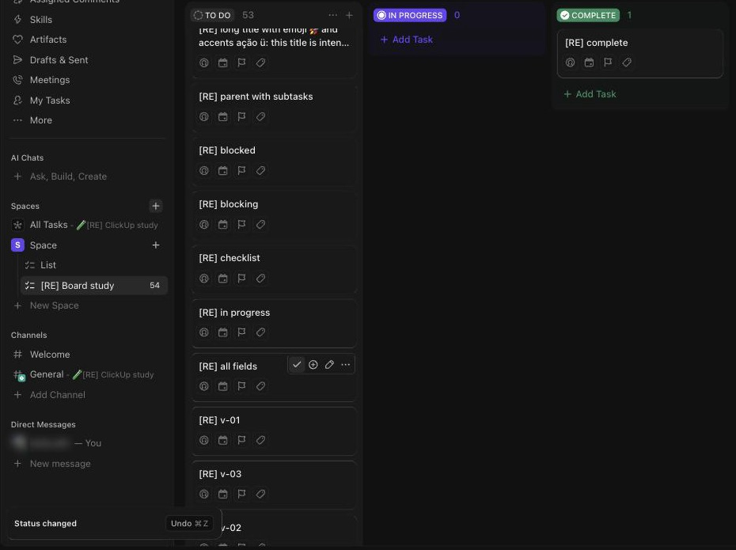

# S-001 Board view of a list
Features: F-001 to F-008, F-016 to F-018, F-024 to F-026 · URL: `/:team/v/b/li/:list` · Status: reviewed

## Purpose

Shows the tasks of one list as columns. Each column is one value of the grouping field (status by default) and holds one card per task. The user reads progress at a glance, edits task fields on the card, creates tasks inside a column and opens a task in full.

## Entry points

- Views bar of a list: the "Board" tab, created by default with every new list next to "List" [obs EV-002].
- URL `/:team/v/b/li/:list` opens the list's default board view; saved views also open at `/:team/v/li/:list/:view` [obs EV-011].
- Sidebar: Space > list > the last view opened.

## Anatomy

| # | Region | Contents | Component | Evidence |
|---|---|---|---|---|
| 1 | Location header | Breadcrumb (Space / List with a menu), favorite star; right side: call, Agents, automation, AI, Share | | [obs EV-012] |
| 2 | Views bar | "Add Channel", view tabs (List, Board), "+ View" | | [obs EV-002] |
| 3 | View toolbar, left | "Group: Status" button, "Subtasks" button; "Save view" appears here when the view has unsaved changes | C-003 | [obs EV-017] |
| 4 | View toolbar, right | Sort, Filter, Closed (disabled while grouped by status), Assignee filter, Me-mode avatar, search, Customize, Add Task split button | C-003 | [obs EV-012][obs EV-026] |
| 5 | Column strip | One column per group value, then "+ Add group" at the end; horizontal scroll when wider than the screen | C-002 | [obs EV-012][obs EV-038] |
| 6 | Column header | Status pill in the status color, task count; on hover: collapse, More (Group options), + (add task at top) | C-002 | [obs EV-015][obs EV-016] |
| 7 | Card list | Virtualized list of cards, then "+ Add Task" in the column footer | C-001 | [obs EV-046] |
| 8 | Bulk action bar | Bottom of the screen, only while tasks are selected | C-006 | [obs EV-028] |
| 9 | Toasts | Bottom left: Task created, Status changed with Undo, prompts | C-008 | [obs EV-012][obs EV-030] |

Board DOM: Angular 22 custom elements `cu3-board-view` > `cu3-board` > `cu3-board-header` (column headers) and `cu3-board-group` (columns, with `cdk-virtual-scroll-viewport`) > `cu3-board-task` (cards) [obs EV-011].

## Data shown

| Element | Entity.field | Evidence |
|---|---|---|
| Column | Status.status, Status.color, Status.type (one column per status of the list) | [net EV-014][obs EV-038] |
| Column count | number of tasks in the group, closed included in the closed column | [obs EV-046] |
| Card title | Task.name | [obs EV-012] |
| Assignee chip | Task.assignees (avatar) | [obs EV-041] |
| Date chip | Task.start_date, Task.due_date (relative text, colored by urgency) | [obs EV-010] |
| Priority chip | Task.priority (flag color and label) | [obs EV-006] |
| Tags | Task.tags (name pills) | [obs EV-040] |
| Status chip | Task.status, only when the board is not grouped by status | [obs EV-026] |
| Custom field rows | CustomFieldValue per shown field, one row each with the type icon (C-019) | [obs EV-121][net EV-112] |

## States

| State | How to reach it | What it shows | Evidence |
|---|---|---|---|
| Empty | New list | Three columns (to do, in progress, complete) with only "+ Add Task", then "+ Add group" | [obs EV-002] |
| Loading | Open the board, or change grouping or card settings | Column header skeletons and card skeletons; field values on cards can fill in after the titles | [obs EV-018] |
| Typical | Fixtures | Cards with chips for filled fields and empty placeholders for the rest | [obs EV-012] |
| Custom fields shown | Customize > Fields, all 22 on | A row per field on every card; empty values "-" or a type placeholder | [obs EV-120][obs EV-121] |
| Many items | 53 tasks in one column | Column scrolls on its own; only about 11 cards exist in the DOM; more load while scrolling | [obs EV-046][net EV-014] |
| Long text | 200+ character title with emoji and accents | Title wraps to two lines and ends with an ellipsis; card height grows | [obs EV-012] |
| Collapsed column | Column menu > Collapse group | Vertical strip with the status name rotated and the count | [obs EV-017] |
| Grouped by another field | Group: Priority | Columns Urgent, High, Normal, Low, No priority; cards show a status chip; closed tasks hidden | [obs EV-026] |
| Swimlanes | Group > Add subgroup | Rows per second field, each collapsible with its own count and + | [obs EV-027] |
| Error | Not reached | | |
| No permission | Not testable with one account (needs L1 and a second user) | | |
| Plan-gated | WIP limits (Business) | Not available on Free Forever | [doc SRC-011] |

## Interactions

| Trigger | Result | Request | Persistence scope | Evidence |
|---|---|---|---|---|
| Card flag icon > a priority | Priority chip appears at once | `PUT /tasks/v1/item?check_dependencies` | Task (server) | [net EV-007][obs EV-006] |
| Card calendar icon > date > close picker | Date chip appears; saved only when the picker closes | `PUT /tasks/v1/item?...check_remap_subtasks` | Task | [net EV-014][obs EV-010] |
| Card person icon > Me | Avatar on the card; prompt to add to personal priorities | `PUT /tasks/v1/task/:id?...field_backlinks` | Task | [net EV-014][obs EV-042] |
| Card tag icon > type a new name > Enter > close | Tag created at Space level and applied | `POST /tasks/v1/tag` on close | Space tag + task | [net EV-014][obs EV-040] |
| Hover toolbar ✓ Mark complete | Card moves to the closed column, toast "Status changed" with Undo ⌘Z | `PUT /tasks/v1/item?...check_resolved` | Task | [obs EV-012][net EV-014] |
| Column + or "+ Add Task" | Inline create form inside the column | `POST` create (not captured) | Task | [obs EV-029] |
| Column More > Collapse group | Column collapses; "Save view" appears | none until saved; a view re-query | View draft (lost on reload) | [obs EV-017][net EV-014] |
| "+ Add group" > name > ✓ | Scope dialog, then a new status column | not captured | List statuses | [obs EV-037][obs EV-038] |
| Column More > Select all | Cards get a checked box; bulk bar opens | none | Browser memory | [obs EV-028] |
| Scroll inside a column | More cards render | `POST /task-v3/experience/:id/tasks/bulk` | none | [net EV-014][obs EV-046] |
| Card title click | Opens the task (S-002) | | | |
| Drag a card to another column | Changes the group value (status) | | Task | [doc SRC-012] (not observed: F-005 blocked) |
| Customize > card size, cover, toggles | Board re-renders; "Save view" appears | view re-query | View draft | [obs EV-020][obs EV-023] |
| Customize > Fields > a custom field toggle | The field gets a row on every card; "Save view" appears | view re-query | View draft (lost on reload) | [obs EV-120][obs EV-123][obs EV-124] |
| Card custom field value | Opens the field editor on the card (same picker as the task view) | `POST /customFields/v1/task/:id/field/:id` | Task | [obs EV-122][net EV-112] |

## Keyboard and accessibility

| Check | Result | Evidence |
|---|---|---|
| Tab order | Card title link, then the hover toolbar buttons (Mark complete, Add subtask, Rename, More), then the four field toggles | [obs EV-034] |
| Arrow keys | Down arrow does not move between cards | [obs EV-034] |
| Shortcuts | Priority picker items show ⌘1 to ⌘4 and ⌘0; documented global shortcuts in SRC-046 not exercised on the board | [obs EV-006][doc SRC-046] |
| Focus visible | Field toggles: white 1px ring plus a 3px dark halo; the title link has no outline | [obs EV-033][obs EV-035] |
| Escape | Closes pickers and menus; closing the date picker saves | [net EV-014] |
| Unlabeled controls | Card open area, field toggles and the Add subtask button have no accessible name | [obs EV-011][obs EV-034] |

## Microcopy

| Element | Text | Evidence |
|---|---|---|
| Column menu title | "Group options" | [obs EV-015] |
| Toast after complete | "Status changed" · "Undo ⌘Z" | [obs EV-012] |
| Toast after create | "Task created" · "Pin to bottom 3" · "Copy URL 2" · "View task 1" | [obs EV-030] |
| New status dialog | "Where should this new status apply?" · "List only" · "Entire Space" | [obs EV-037] |
| Inline form | "Task Name..." · "Save ↵" · "Add assignee" · "Add dates" · "Add priority" · "Add tag" | [obs EV-029] |
| Draft indicator | "Save view" | [obs EV-017] |

## Rules

- R-001 to R-018 in `rules/board.md`.
- R-048 to R-050 in `rules/custom-fields.md` (custom fields on cards).

## Realtime and performance

| Check | Result | Evidence |
|---|---|---|
| A change in a second tab appears without reload | Yes, within about 8 s in a background tab | [obs EV-031][obs EV-032] |
| Loading pattern (skeleton, spinner, optimistic update) | Skeletons on load and on view changes; field edits show at once (optimistic) | [obs EV-018][obs EV-006] |
| Delays the user sees | Card field values seemed to fill in after the titles; not measurable in a background tab | Q-001 |

## Responsive

| Width | Change | Evidence |
|---|---|---|
| 1710 CSS px | All observations | [obs EV-046] |
| 1024 and 390 | Not tested: the window belongs to the user and was not resized | |

## Not tested

- Drag and drop (F-005): the tool's drag and synthetic events do not move cards. Needs a human or a real mouse driver.
- Sort options and saved filters: popovers opened only (EV-039); no filter applied.
- Save view, Autosave, Private, Protect, Set as default: not clicked, to keep the default view clean; Private and Default need Business [doc SRC-014].
- WIP limits (Business), Me mode, the Subtasks toggle options, card cover with an image.
- Error and no-permission states.
- Widths 1024 and 390 px.
