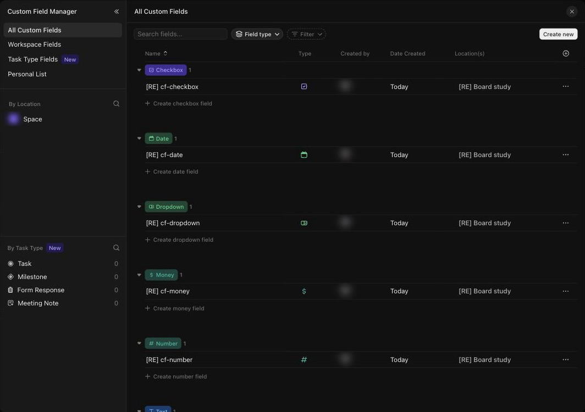

# S-003 Custom Field Manager
Features: F-016, F-019 to F-021 · URL: a modal over `/:team/settings/...` (no route of its own seen) · Status: reviewed

## Purpose

Lists every custom field of the workspace in one place, grouped by type, with where each one lives. From here the user creates fields, opens a field's settings and sees which locations and task types use it.

## Entry points

- Settings > Features > Custom Field Manager [obs EV-133][obs EV-134].
- The gear in a view's Fields panel and the workspace menu also open it [doc SRC-006].

## Anatomy

| # | Region | Contents | Component | Evidence |
|---|---|---|---|---|
| 1 | Left rail, top | All Custom Fields, Workspace Fields, Task Type Fields (New), Personal List | | [obs EV-098] |
| 2 | Left rail, By Location | Search and the location tree (Space) | | [obs EV-098] |
| 3 | Left rail, By Task Type | Task, Milestone, Form Response, Meeting Note, each with a count | | [obs EV-098] |
| 4 | Toolbar | Search fields, Field type grouping, Filter, Create new | | [obs EV-098] |
| 5 | Table | One group per type (pill with icon and count), rows Name, Type icon, Created by, Date Created, Location(s), row menu; "+ Create <type> field" under each group | | [obs EV-098] |
| 6 | Create new menu | AI Fields (Summary, Custom Text, Custom Dropdown), then All types | C-018 | [obs EV-096][obs EV-097] |

## Data shown

| Element | Entity.field | Evidence |
|---|---|---|
| Name | CustomField.name | [obs EV-098][net EV-099] |
| Type | CustomField.type | [obs EV-098][net EV-099] |
| Created by | CustomField.userid (masked) | [obs EV-098][net EV-099] |
| Date Created | CustomField.date_created | [obs EV-098][net EV-099] |
| Location(s) | CustomFieldLocation.parent | [obs EV-098][net EV-099] |
| Task type counts | CustomField bound to task types | [obs EV-098] |

## States

| State | How to reach it | What it shows | Evidence |
|---|---|---|---|
| Empty | New workspace, or after teardown | "No matching results found" and a Create field button | [obs EV-045][obs EV-134] |
| Loading | Not seen | | |
| Typical | 22 list-level fields | Groups by type, one row each | [obs EV-098] |
| Many items | Not reached | | |
| Long text | Not tested | | |
| Error | Not reached | | |
| No permission | Needs a second, non-admin account (L1) | | |
| Plan-gated | Moving and merging fields, task-type fields | Business Plus and above [doc SRC-006][doc SRC-008] | |

## Interactions

| Trigger | Result | Request | Persistence scope | Evidence |
|---|---|---|---|---|
| Create new > type | The field form (C-018), with the location to choose | `POST /customFields/v2/field`, then `PUT .../fields/:id/locations` | Workspace (field) + location | [obs EV-097][net EV-099] |
| Group pill arrow | Collapses a type group | none seen | Browser | [obs EV-098] |
| Left rail item | Filters the table (Workspace Fields, Personal List, a location, a task type) | `GET /customFields/v2/field` | none | [obs EV-134] |

## Keyboard and accessibility

| Check | Result | Evidence |
|---|---|---|
| Tab order | Not walked | |
| Arrow keys | Not checked | |
| Shortcuts | None seen | |
| Focus visible | Not checked | |
| Escape | Not checked | |
| Unlabeled controls | Not checked | |

## Microcopy

| Element | Text | Evidence |
|---|---|---|
| Empty table | "No matching results found" · "Create field" | [obs EV-134] |
| Group footer | "Create <type> field" | [obs EV-098] |

## Rules

- R-034, R-040, R-054, R-055 in `rules/custom-fields.md`.

## Realtime and performance

| Check | Result | Evidence |
|---|---|---|
| A change in a second tab appears without reload | Not checked | |
| Loading pattern (skeleton, spinner, optimistic update) | Not seen | |
| Delays the user sees | Not measured | |

## Responsive

| Width | Change | Evidence |
|---|---|---|
| 1710 CSS px | Modal of about 1060 × 750 screenshot px | [obs EV-098] |

## Not tested

- Editing a field from the manager, moving and merging fields (Business Plus), filters other than the left rail, the row menu.
- Workspace, Space and Folder locations: every study field lived on one list.
- Task-type fields (Business Plus [doc SRC-008]).
- The 7 "Custom Fields in Workspace" seen in the view Fields panel never appear here (B-007, Q-002).
