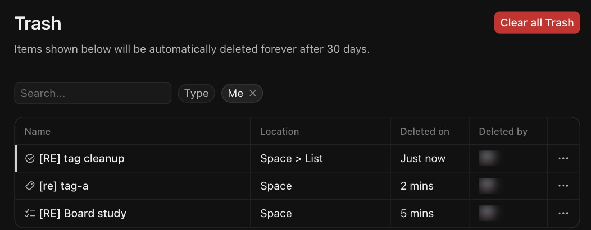

# S-005 Trash
Features: F-020 · URL: `/:team/settings/trash` · Status: reviewed

## Purpose

Lists what was deleted in the workspace (lists, tasks, tags, custom fields) so an admin can restore it within 30 days or delete it forever.

## Entry points

- Settings > Admin > Trash [obs EV-128].
- The delete dialogs for fields mention it ("restore deleted fields from the Trash") and the list delete toast links to it ("List moved to trash") [obs EV-126][obs EV-132].

## Anatomy

| # | Region | Contents | Component | Evidence |
|---|---|---|---|---|
| 1 | Header | "Trash", the 30-day notice, "Clear all Trash" (red) | | [obs EV-137] |
| 2 | Filters | Search, Type, "Me" (on by default, removable) | | [obs EV-128] |
| 3 | Table | Name with type icon, Location (path), Deleted on (relative), Deleted by (avatar), row menu | | [obs EV-137] |
| 4 | Row menu | Restore, Delete forever | | [obs EV-128] |

## Data shown

| Element | Entity.field | Evidence |
|---|---|---|
| Name and icon | the deleted object and its kind (list, task, tag, field) | [obs EV-137] |
| Location | parent path ("Space > List", "1 location" for a field) | [obs EV-128][obs EV-137] |
| Deleted on | deletion time, relative | [obs EV-137] |
| Deleted by | user (masked) | [obs EV-137] |

## States

| State | How to reach it | What it shows | Evidence |
|---|---|---|---|
| Empty | Nothing deleted by the current user | Trash icon and "No items found for your search." | [obs EV-128] |
| Typical | Deleted list, tag and task | One row each | [obs EV-137] |
| Loading | Not seen | | |
| Many items | Not reached | | |
| Long text | Not tested | | |
| Error | Not reached | | |
| No permission | Needs a non-admin account (L1) | | |
| Plan-gated | None seen | | |

## Interactions

| Trigger | Result | Request | Persistence scope | Evidence |
|---|---|---|---|---|
| Row menu > Restore | The item leaves the list and comes back where it was, with its values | not captured | Workspace | [obs EV-129] |
| Row menu > Delete forever | Not clicked (permanent) | | | |
| Clear all Trash | Not clicked (permanent) | | | |

## Keyboard and accessibility

| Check | Result | Evidence |
|---|---|---|
| Tab order | Not walked | |
| Arrow keys | Not checked | |
| Shortcuts | None seen | |
| Focus visible | Not checked | |
| Escape | Not checked | |
| Unlabeled controls | The row menu button shows only "…" | [obs EV-128] |

## Microcopy

| Element | Text | Evidence |
|---|---|---|
| Notice | "Items shown below will be automatically deleted forever after 30 days." | [obs EV-128] |
| Empty | "No items found for your search." | [obs EV-128] |

## Rules

- R-052, R-053 in `rules/custom-fields.md`.

## Realtime and performance

| Check | Result | Evidence |
|---|---|---|
| A change in a second tab appears without reload | Not checked | |
| Loading pattern (skeleton, spinner, optimistic update) | Not seen | |
| Delays the user sees | None noticed | |

## Responsive

| Width | Change | Evidence |
|---|---|---|
| 1710 CSS px | Settings layout with a left menu | [obs EV-128] |

## Not tested

- Delete forever and Clear all Trash (permanent deletion; out of bounds for the agent).
- Restoring a list or a tag; the Type filter; the view with "Me" removed.
- Who may restore (the delete dialog says admins).
