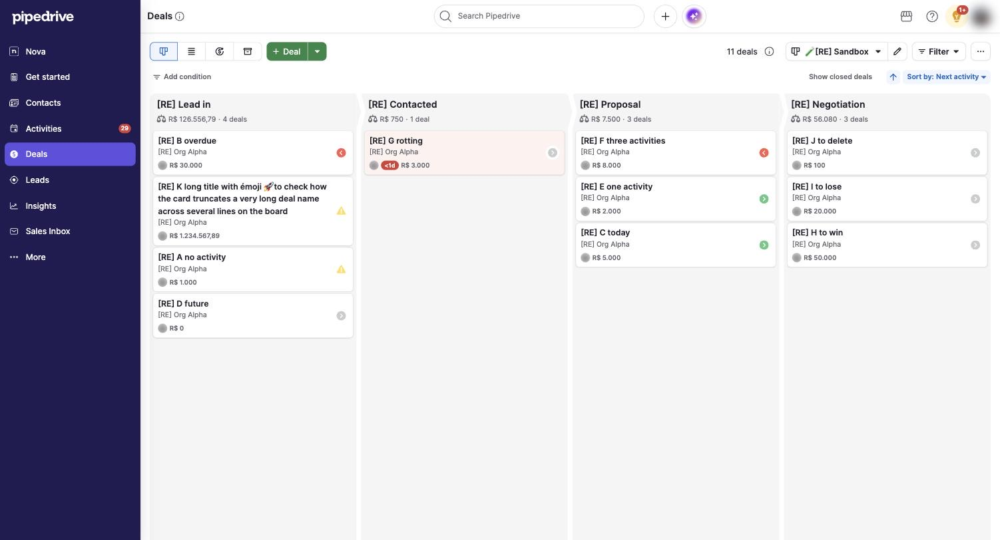

# C-001 Deal card
Product name: `data-test=pipeline-deal-tile` · Used in: S-001 · Status: done

## Anatomy

| # | Part | Content | Evidence |
|---|---|---|---|
| 1 | Title | Deal title, bold, wraps without truncation | [obs EV-010] |
| 2 | Second line | Organization name (or person) in grey | [obs EV-010] |
| 3 | Footer | Owner avatar, rotting badge when rotten, value in bold | [obs EV-010] [obs EV-016] |
| 4 | Status icon | C-002 on the right edge, vertically centered | [obs EV-010] |
| 5 | NEW badge | Blue pill after the title of a deal just created in this session view | [obs EV-053] |

## Variants

| Variant | Difference | Evidence |
|---|---|---|
| Rotting | Pale pink background, red "<1d" pill before the value | [obs EV-016] |
| Just created | NEW badge; placed first in its stage until reload | [obs EV-053] |
| Long title | Three lines; card grows | [obs EV-010] |

## States

| State | Visual change | Evidence |
|---|---|---|
| Default | White card, 8 px radius, light shadow | [obs EV-002] |
| Hover | not measured | none |
| Focus | not measured | none |
| Pressed | not measured | none |
| Selected | not measured | none |
| Disabled | none | none |
| Loading | none | none |
| Error | none | none |
| Dragging | Drop zones appear at the bottom of the board | [obs EV-054] |

## Measurements and tokens

| Property | Value | Token | Evidence |
|---|---|---|---|
| Card size | about 342 × 75 px at 1710 px viewport (one-line title) | none | [obs EV-011] |
| Radius | 8 px | `--pd-radius-m` | [obs EV-002] |
| Shadow | rgba(42, 54, 71, 0.05) 0 1px 2px 0 | none | [obs EV-002] |
| Title | Inter 14/21 600 | none | [obs EV-002] |
| Secondary text | Inter 12/18 450, rgb(101, 104, 111) | `--pd-color-text-secondary` | [obs EV-002] |

## Behavior

- Clicking the title opens S-002. Clicking the status icon opens C-002's popover instead of the deal [obs EV-019].
- Dragging starts the drop-zone mode (Delete, Lost, Won, Move to) [obs EV-054].

## Keyboard and accessibility

| Role | Accessible name | Keys | Focus visible | Evidence |
|---|---|---|---|---|
| none recorded | title text | not tested | not tested | [obs EV-001] |

## Not tested

- Hover, focus and selected styles; keyboard access to cards.
- Card customization (up to 7 extra fields per user and pipeline per the docs [doc SRC-003]).
