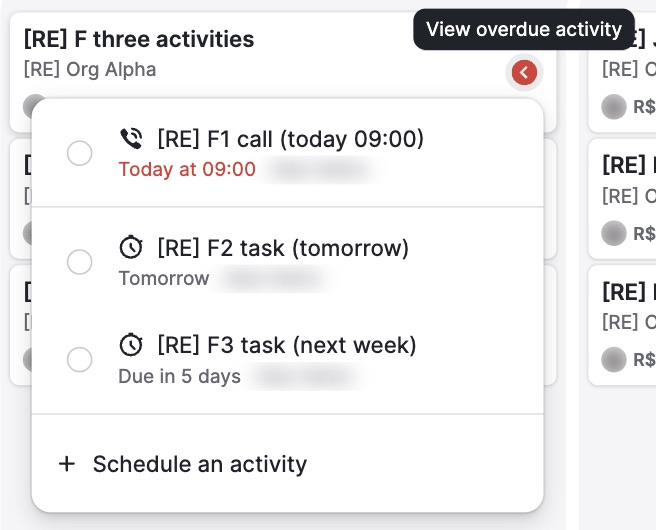

# C-002 Activity status icon and popover
Product name: `data-test=activity-status-indicator-:id` · Used in: S-001 · Status: done

## Anatomy

| # | Part | Content | Evidence |
|---|---|---|---|
| 1 | Icon | 24 px circle: red with "<" (overdue), green with ">" (today), grey with ">" (future), yellow triangle with "!" (no open activity) | [obs EV-010] |
| 2 | Tooltip | One line per state (see microcopy in S-001) | [obs EV-012] [obs EV-013] [obs EV-014] [obs EV-015] |
| 3 | Popover list | One row per open activity: done circle, type icon, subject, relative due ("Today at 09:00", "Tomorrow", "Due in 5 days") and owner | [obs EV-019] |
| 4 | Popover footer | "+ Schedule an activity" | [obs EV-019] |
| 5 | Empty popover | "You have no activities scheduled for this deal" and "+ Schedule an activity" | [obs EV-018] |

## Variants

| Variant | Difference | Evidence |
|---|---|---|
| Overdue | Red; the overdue row's date in red | [obs EV-019] |
| Today | Green; date in green | [obs EV-015] |
| Future | Grey | [obs EV-014] |
| None | Yellow warning triangle | [obs EV-013] |

## States

| State | Visual change | Evidence |
|---|---|---|
| Default | Icon only | [obs EV-010] |
| Hover | Grey halo and a dark tooltip | [obs EV-012] |
| Focus | not measured | none |
| Pressed | Popover opens below | [obs EV-019] |
| Selected | Row turns blue after its circle is clicked, subject struck through, green check | [obs EV-020] |
| Disabled | none | none |
| Loading | none seen | none |
| Error | none | none |

## Measurements and tokens

| Property | Value | Token | Evidence |
|---|---|---|---|
| Icon size | 24 × 24 px | none | [obs EV-011] |
| Red | rgb(216, 60, 56) | `--pd-color-negative-default` | [obs EV-002] |
| Green | rgb(45, 134, 71) | `--pd-color-primary-default` | [obs EV-002] |
| Yellow | rgb(209, 184, 0) | `--pd-non-semantic-color-lemon-yellow-108` | [obs EV-002] |

## Behavior

- The state follows the deal's earliest open activity; an activity due today whose time has passed is overdue (R-002).
- Marking a row done updates the icon in place; if it was the last open activity the next-activity modal opens (R-013, R-014).

## Keyboard and accessibility

| Role | Accessible name | Keys | Focus visible | Evidence |
|---|---|---|---|---|
| button | tooltip text | Escape closes the popover | not tested | [obs EV-019] |

## Not tested

- Keyboard opening of the popover; screen reader names of the rows.
