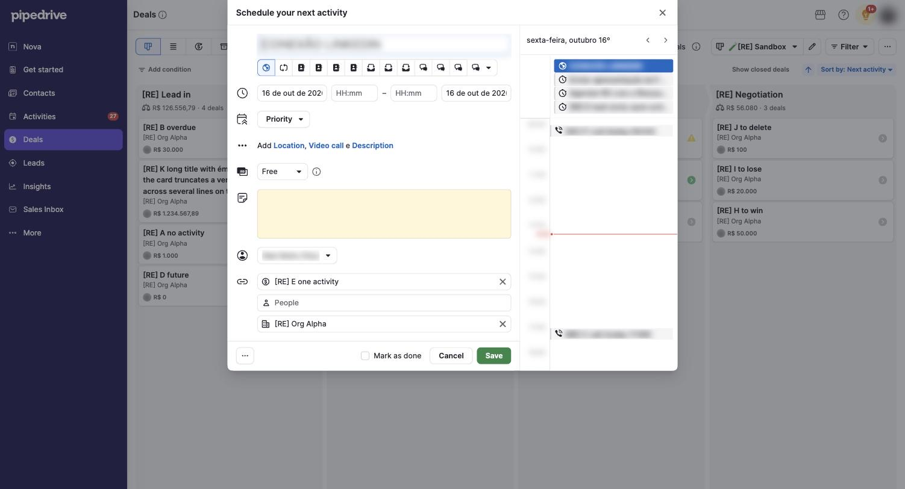

# C-003 Activity form modal
Product name: `data-test=add-activity-form` · Used in: S-001, S-002, S-004 · Status: done

## Anatomy

| # | Part | Content | Evidence |
|---|---|---|---|
| 1 | Title | "Schedule your next activity" (after the last open activity is done) or "Schedule an activity" (other entry points) | [obs EV-022] [obs EV-036] |
| 2 | Subject | Large input; placeholder is the selected type's name | [obs EV-022] |
| 3 | Type row | 12 type icons and a menu with the rest; the first type is selected | [obs EV-022] [obs EV-036] |
| 4 | When | Start date, start time, end time, end date; date format "16 de out de 2026" | [obs EV-022] |
| 5 | Priority | Menu | [obs EV-022] |
| 6 | More | "Add Location, Video call e Description" (progressive disclosure) | [obs EV-022] |
| 7 | Availability | Free/Busy menu with info icon | [obs EV-022] |
| 8 | Note | Yellow text area | [obs EV-022] |
| 9 | Owner | User menu, current user preselected | [obs EV-022] |
| 10 | Links | Deal (prefilled), People, Organization (prefilled from the deal) | [obs EV-022] |
| 11 | Footer | "...", "Mark as done" checkbox, Cancel, Save | [obs EV-022] |
| 12 | Day agenda | Right column: weekday and date with arrows, all-day items, hourly timeline, red current-time line, the user's other activities | [obs EV-022] |
| 13 | Context box | After winning: "Follow up after winning a deal · Schedule a follow-up activity to increase your chances for a deal with this client in the future. · Activity settings" | [obs EV-036] |

## Variants

| Variant | Difference | Evidence |
|---|---|---|
| Next activity | Title "Schedule your next activity"; opened by the system | [obs EV-022] |
| Won follow-up | Title "Schedule an activity" with the context box | [obs EV-036] |

## States

| State | Visual change | Evidence |
|---|---|---|
| Default | Form filled with defaults, Free | [obs EV-022] |
| Hover | not measured | none |
| Focus | Subject focused with a blue ring | [obs EV-022] |
| Pressed | none | none |
| Selected | Time chosen: 15-minute list with the chosen slot checked; Free becomes Busy | [obs EV-023] |
| Disabled | none | none |
| Loading | Skeleton bars for 2 to 3 seconds | [obs EV-021] |
| Error | not tested | none |

## Measurements and tokens

| Property | Value | Token | Evidence |
|---|---|---|---|
| Modal width | about 850 CSS px (form about 550, agenda about 300) | none | [net EV-025] |
| Note background | pale yellow | not measured | [obs EV-022] |

## Behavior

- Defaults: type = first active type in company order; date today; no time; Free; owner = current user; deal and organization from context (R-016).
- Clicking the start time fills the next 15-minute slot after now and switches to Busy; the agenda scrolls to the new block (R-017).
- Save creates the activity and shows "Activity added · View" (R-018). Cancel saves nothing.

## Keyboard and accessibility

| Role | Accessible name | Keys | Focus visible | Evidence |
|---|---|---|---|---|
| dialog | title text | Escape closes the time list | yes (subject) | [obs EV-023] |

## Not tested

- Location, video call, description, guests (guests would receive invites), recurrence, "Mark as done" in the form, the "..." menu.
- Validation errors (for example an end time before the start time).
