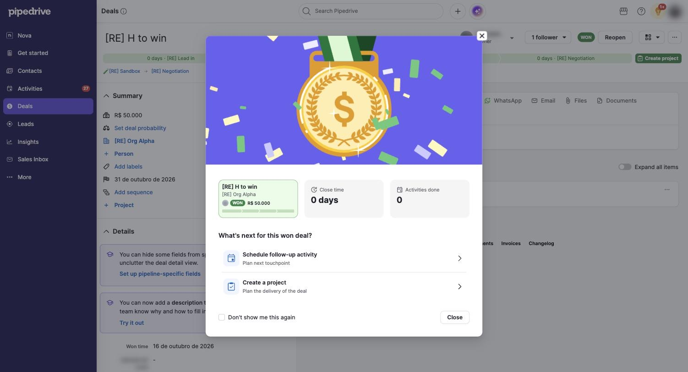

# C-004 Won celebration modal
Product name: none recorded · Used in: S-002 · Status: done

## Anatomy

| # | Part | Content | Evidence |
|---|---|---|---|
| 1 | Illustration | Animated medal and confetti on a purple band (do not copy the art) | [obs EV-034] |
| 2 | Deal card | Title, organization, owner avatar, WON pill, value, stage progress line | [obs EV-034] |
| 3 | Stats | "Close time 0 days"; "Activities done 0" | [obs EV-034] |
| 4 | Question | "What's next for this won deal?" | [obs EV-034] |
| 5 | Choices | "Schedule follow-up activity · Plan next touchpoint"; "Create a project · Plan the delivery of the deal" | [obs EV-034] |
| 6 | Footer | "Don't show me this again" checkbox; Close; close icon | [obs EV-034] |

## Variants

| Variant | Difference | Evidence |
|---|---|---|
| Animation off | not tested (personal preference) | none |

## States

| State | Visual change | Evidence |
|---|---|---|
| Default | Shown about 4 seconds after Won, after two report calls | [obs EV-034] |
| Hover | not measured | none |
| Focus | not measured | none |
| Pressed | none | none |
| Selected | none | none |
| Disabled | none | none |
| Loading | none seen | none |
| Error | none | none |

## Measurements and tokens

| Property | Value | Token | Evidence |
|---|---|---|---|
| Width | about 600 px at 1502 px screenshot width | none | [obs EV-034] |

## Behavior

- "Schedule follow-up activity" opens C-003 with the won context box (R-024).
- "Don't show me this again" changes a personal preference (A3; not clicked).

## Keyboard and accessibility

| Role | Accessible name | Keys | Focus visible | Evidence |
|---|---|---|---|---|
| dialog | not recorded | not tested | not tested | none |

## Not tested

- "Create a project", "Don't show me this again", Escape and keyboard order.
