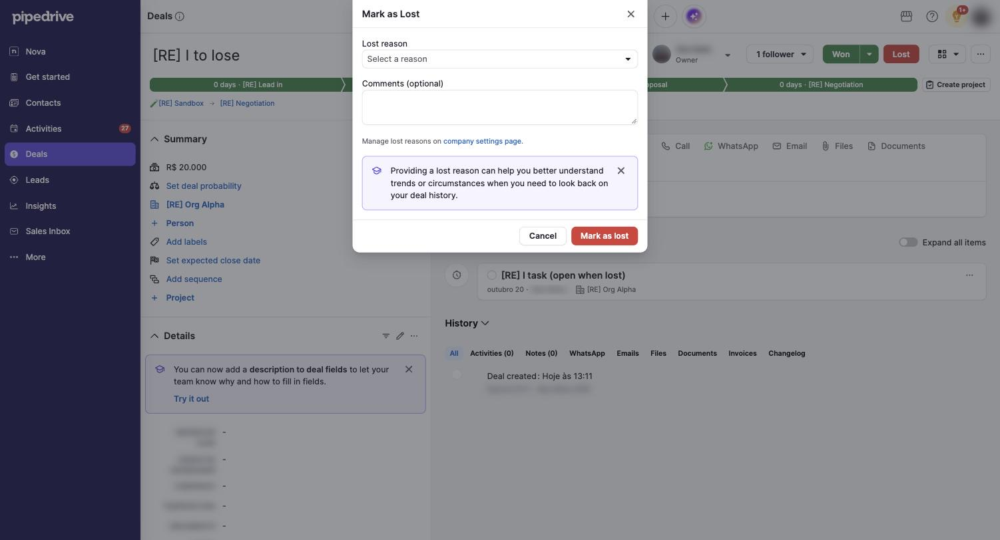

# C-005 Mark as lost dialog
Product name: none recorded · Used in: S-002 · Status: done

## Anatomy

| # | Part | Content | Evidence |
|---|---|---|---|
| 1 | Title | "Mark as Lost" with close icon | [obs EV-038] |
| 2 | Lost reason | Select "Select a reason"; opens a searchable list of company reasons | [obs EV-038] [obs EV-040] |
| 3 | Comments | "Comments (optional)" text area | [obs EV-038] |
| 4 | Link | "Manage lost reasons on company settings page." | [obs EV-038] |
| 5 | Tip | "Providing a lost reason can help you better understand trends or circumstances when you need to look back on your deal history." (dismissible) | [obs EV-038] |
| 6 | Footer | Cancel; red "Mark as lost" | [obs EV-038] |

## Variants

| Variant | Difference | Evidence |
|---|---|---|
| Predefined reasons | Searchable select; free text is not accepted | [obs EV-041] |

## States

| State | Visual change | Evidence |
|---|---|---|
| Default | Empty reason | [obs EV-038] |
| Hover | not measured | none |
| Focus | Search input focused when the list opens | [obs EV-040] |
| Pressed | none | none |
| Selected | Reason shown in the select | [obs EV-042] |
| Disabled | none | none |
| Loading | none | none |
| Error | Red border on the select when submitting without a reason; no message; nothing sent | [obs EV-039] |

## Measurements and tokens

| Property | Value | Token | Evidence |
|---|---|---|---|
| Error border | red | `--pd-color-negative-default` | [obs EV-039] [obs EV-002] |

## Behavior

- Submitting sends the reason and the status, then creates a note pinned to the deal from the comment (R-029).

## Keyboard and accessibility

| Role | Accessible name | Keys | Focus visible | Evidence |
|---|---|---|---|---|
| combobox | Lost reason | Enter does nothing when the search matches nothing | yes | [obs EV-041] |

## Not tested

- Keyboard selection of a reason; the dialog with no predefined reasons (free-form text, Q-003).
