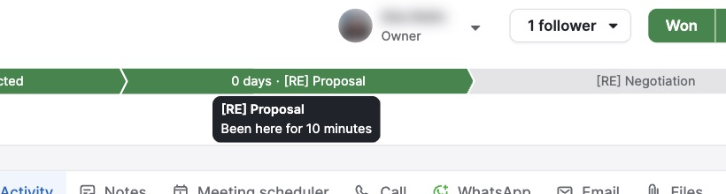

# C-006 Stage bar
Product name: none recorded · Used in: S-002 · Status: done

## Anatomy

| # | Part | Content | Evidence |
|---|---|---|---|
| 1 | Chevron per stage | "N days · stage name"; past and current stages dark green, future grey with the name only | [obs EV-027] |
| 2 | Tooltip | Current: "stage · Been here for N minutes"; future: "This deal has not been in this stage yet" | [obs EV-028] [obs EV-029] |

## Variants

| Variant | Difference | Evidence |
|---|---|---|
| Won | All chevrons light green | [obs EV-035] |
| Lost | All chevrons light red | [obs EV-042] |
| Deleted | All chevrons grey | [obs EV-046] |

## States

| State | Visual change | Evidence |
|---|---|---|
| Default | Open deal colors | [obs EV-027] |
| Hover | Tooltip | [obs EV-028] |
| Focus | not measured | none |
| Pressed | Deal moves to the clicked stage at once | [obs EV-032] |
| Selected | Current stage is the last green chevron | [obs EV-027] |
| Disabled | not tested on closed deals | none |
| Loading | none | none |
| Error | none | none |

## Measurements and tokens

| Property | Value | Token | Evidence |
|---|---|---|---|
| Height | about 20 px | none | [obs EV-027] |

## Behavior

- Stages before the one the deal was created in show as passed with "0 days" (R-031).
- A click moves the deal without confirmation, after a required-field pre-check (R-030).

## Keyboard and accessibility

| Role | Accessible name | Keys | Focus visible | Evidence |
|---|---|---|---|---|
| not recorded | not recorded | not tested | not tested | none |

## Not tested

- Clicking a stage on a won or lost deal; moving back to an earlier stage; what the pre-check shows when a required field is missing.
