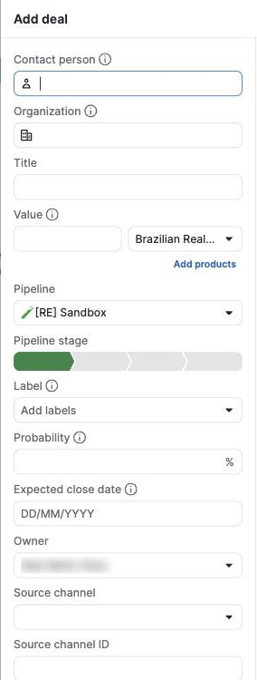

# C-007 Add deal modal
Product name: none recorded · Used in: S-001 · Status: done

## Anatomy

| # | Part | Content | Evidence |
|---|---|---|---|
| 1 | Contact person | Autocomplete with info icon; focused on open | [obs EV-049] |
| 2 | Organization | Autocomplete with info icon | [obs EV-049] |
| 3 | Title | Text | [obs EV-049] |
| 4 | Value | Number and currency select (company currency preselected); "Add products" | [obs EV-049] |
| 5 | Pipeline | Current pipeline | [obs EV-049] |
| 6 | Pipeline stage | Segmented chevrons, first stage selected | [obs EV-049] |
| 7 | Label, Probability (%), Expected close date (DD/MM/YYYY), Owner, Source channel, Source channel ID | Fields | [obs EV-049] |
| 8 | Custom fields | Company deal fields, then Visible to | [obs EV-052] |
| 9 | Right column | PERSON (phone, email and person fields) and ORGANIZATION (organization fields) for new contacts | [obs EV-050] |
| 10 | Footer | Import; usage counter "used/limit" with info icon; Cancel; Save | [obs EV-050] |

## Variants

| Variant | Difference | Evidence |
|---|---|---|
| Unmatched organization | NEW badge in the field; option "Add 'text' as new organization" | [obs EV-051] |

## States

| State | Visual change | Evidence |
|---|---|---|
| Default | Empty, contact person focused | [obs EV-049] |
| Hover | not measured | none |
| Focus | Blue ring | [obs EV-049] |
| Pressed | none | none |
| Selected | Existing organization chosen: NEW badge disappears | [obs EV-051] |
| Disabled | Save dims while validation errors show | [obs EV-050] |
| Loading | Spinner in the organization field while searching | [obs EV-051] |
| Error | "A person or organization is required" under both fields | [obs EV-050] |

## Measurements and tokens

| Property | Value | Token | Evidence |
|---|---|---|---|
| Error text | red, 12 px | `--pd-color-negative-default` | [obs EV-050] [obs EV-002] |

## Behavior

- Save sends `POST /api/v1/deals` with pipeline, stage, owner, title, organization and visibility, then refreshes the stage count (R-040).

## Keyboard and accessibility

| Role | Accessible name | Keys | Focus visible | Evidence |
|---|---|---|---|---|
| dialog | Add deal | not tested | yes | [obs EV-049] |

## Not tested

- Creating a person from the right column; products; labels; import; custom field validation.
