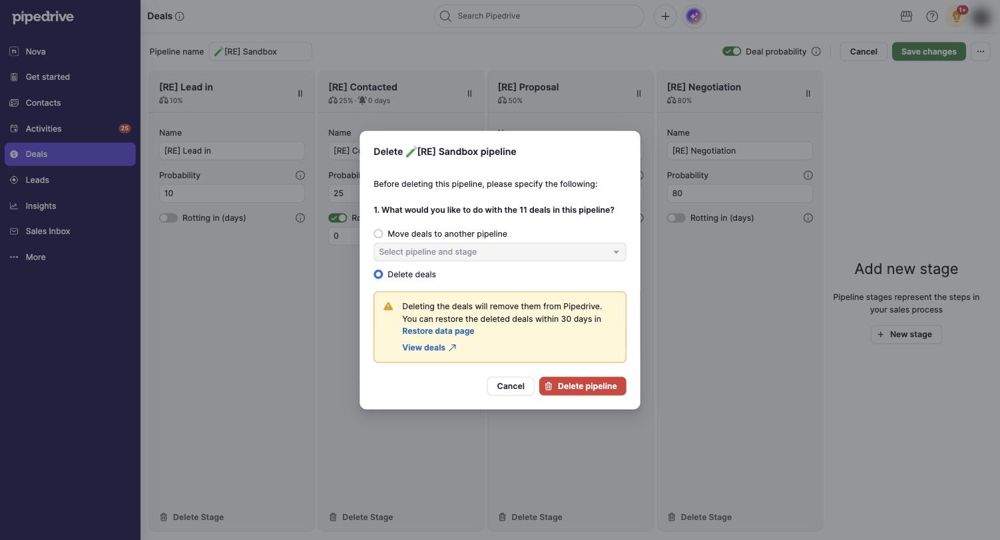

# C-008 Delete confirmations
Product name: none recorded · Used in: S-002, S-003, S-005 · Status: done

## Anatomy

| # | Part | Content | Evidence |
|---|---|---|---|
| 1 | Deal | "Are you sure you want to delete this deal? Any notes, files, documents and invoices linked to this deal will also be deleted." Info box: restore from Restore data within 30 days. Cancel / Delete deal | [obs EV-045] |
| 2 | Note | "Are you sure you want to delete this note? This action cannot be undone." Cancel / Delete | [obs EV-043] |
| 3 | Activity | "Are you sure you want to delete this event?" (a line about Restore data appeared on one occasion). Cancel / Delete | [obs EV-048] |
| 4 | Stage (editor) | "Delete (stage) stage · There are no deals in this stage right now." Cancel / Delete stage | [obs EV-007] |
| 5 | Pipeline | "Delete (pipeline) pipeline · Before deleting this pipeline, please specify the following: 1. What would you like to do with the N deals in this pipeline?" Radio: Move deals to another pipeline (default, with a pipeline and stage select) / Delete deals; Delete pipeline disabled until valid | [obs EV-060] |
| 6 | Pipeline, delete deals | Warning: deleting removes the deals; restorable within 30 days; "View deals" link | [obs EV-061] |
| 7 | Organization | "Are you sure you want to delete (name)? All notes, files, documents and invoices on this contact organization are deleted as well. Other linked items may remain but without a linked organization." Restore within 30 days | [obs EV-062] |

## Variants

| Variant | Difference | Evidence |
|---|---|---|
| Destructive | Red primary button with a trash icon | [obs EV-061] |

## States

| State | Visual change | Evidence |
|---|---|---|
| Default | Centered dialog over a dimmed page | [obs EV-045] |
| Hover | not measured | none |
| Focus | not measured | none |
| Pressed | none | none |
| Selected | Radio checked | [obs EV-061] |
| Disabled | "Delete pipeline" pale until a choice is valid | [obs EV-060] |
| Loading | Fade-in of about half a second | [obs EV-060] |
| Error | none | none |

## Measurements and tokens

| Property | Value | Token | Evidence |
|---|---|---|---|
| Danger button | rgb(216, 60, 56) | `--pd-color-negative-default` | [obs EV-002] |

## Behavior

- The deal dialog does not mention activities, and activities survive the deal (R-032).

## Keyboard and accessibility

| Role | Accessible name | Keys | Focus visible | Evidence |
|---|---|---|---|---|
| dialog | title text | not tested | not tested | none |

## Not tested

- Escape and Enter on these dialogs; deleting a person.
