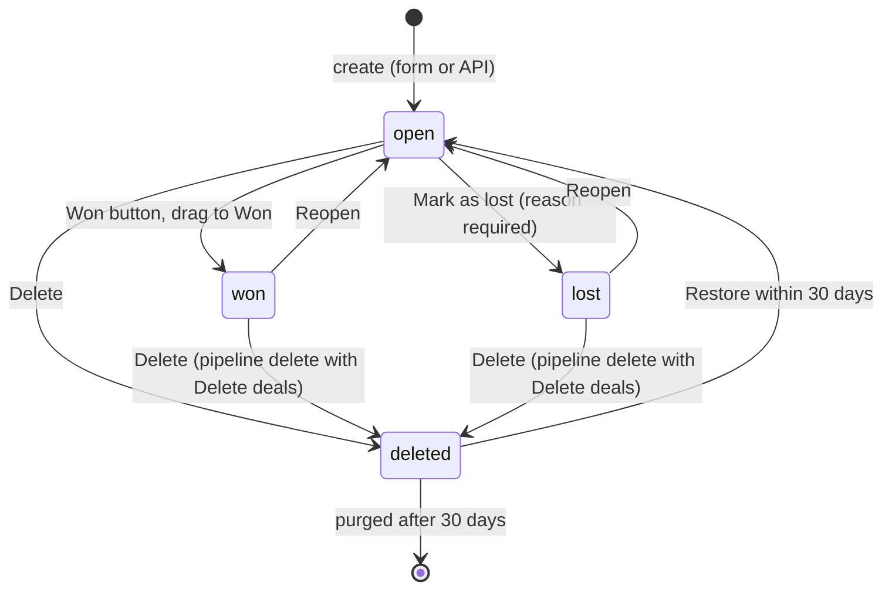

# E-001 Deal
Product term: Deal · Parent: E-004 Stage (within E-003 Pipeline) · Status: draft

## Fields

| Field | Type | Required | Default | Constraints or enum | Source |
|---|---|---|---|---|---|
| id | int | system | | | [net EV-009] |
| title | string | yes | | free text; 120+ characters and emoji accepted | [net EV-009] [obs EV-010] |
| value | number | no | 0 | shown as `R$ 1.234.567,89` | [net EV-009] [obs EV-010] |
| currency | string | yes | company currency | ISO 4217 | [net EV-009] [obs EV-049] |
| pipeline_id | int | yes | current pipeline in the form | | [net EV-009] [net EV-063] |
| stage_id | int | yes | first stage of the pipeline | | [net EV-009] [obs EV-049] |
| status | enum | system | open | open, won, lost (filters also accept deleted) | [net EV-009] [doc SRC-019] |
| owner_id | int | yes | current user | | [net EV-009] [obs EV-049] |
| creator_user_id | int | system | | | [net EV-009] |
| person_id | int or null | one of person or organization in the UI | | | [net EV-009] [obs EV-050] |
| org_id | int or null | one of person or organization in the UI | | | [net EV-009] [obs EV-050] |
| probability | number or null | no | null | 0-100, only when the pipeline allows deal probability | [net EV-009] [doc SRC-006] |
| expected_close_date | date or null | no | | | [net EV-009] |
| lost_reason | string or null | when lost (UI) | | from the company list when predefined reasons exist | [net EV-009] [obs EV-039] |
| visible_to | int | yes | 3 (owner's visibility group) | 1 item owner, 3 owner's group, 5 group and sub-groups, 7 all users | [net EV-009] [obs EV-052] |
| label_ids | int[] | no | [] | | [net EV-009] |
| custom_fields | object | depends on quality rules | | keyed by 40-hex field key | [net EV-009] |
| origin, origin_id, channel, channel_id | string or null | system | origin "Marketplace" for API-created deals | | [net EV-009] |
| acv, arr, mrr | number or null | no | | | [net EV-009] |
| is_archived, archive_time | bool, datetime | system | false | | [net EV-009] |
| is_deleted | bool | system | false | soft delete, purged after 30 days | [net EV-009] [obs EV-046] |

## Relations

| Relation | Target | Cardinality | On delete | Source |
|---|---|---|---|---|
| in stage | E-004 Stage | many to one | pipeline deletion asks to move or delete the deals | [obs EV-060] |
| owner | E-010 User | many to one | not tested | [net EV-009] |
| organization | E-005 Organization | many to one | deleting the organization keeps the deal without it (dialog text) | [obs EV-062] |
| person | E-006 Person | many to one | not tested | [doc SRC-017] |
| activities | E-002 Activity | one to many | deleting the deal leaves its activities open and not deleted | [obs EV-046] [net EV-047] |
| notes | E-007 Note | one to many | the dialog says notes are deleted with the deal | [obs EV-045] |
| followers | E-010 User | many to many | owner follows by default | [obs EV-027] |

## Lifecycle

Evidence: won [obs EV-035], lost [obs EV-042], reopen [obs EV-037], deleted with restore and purge date [obs EV-046].

## System fields

| Field | Set when | Source |
|---|---|---|
| add_time | creation (UTC) | [net EV-009] |
| update_time | any change | [net EV-009] |
| stage_change_time | stage move | [net EV-009] [net EV-033] |
| won_time, lost_time, close_time | status change | [net EV-009] [obs EV-035] [obs EV-042] |
| local_won_date, local_lost_date, local_close_date | status change, in the company time zone | [net EV-009] |
| next_activity_id, next_activity_date, next_activity_time (v1) | activity created, completed or deleted | [net EV-025] |
| undone_activities_count, done_activities_count, activities_count (v1) | activity changes | [net EV-025] |
| first_won_time (v1) | first win | [net EV-025] |

## Rules

- R-001, R-003, R-022, R-025, R-026, R-027, R-029, R-030, R-032, R-037, R-039, R-040

## Not tested

- Products, labels, sequences, projects, archive, merge, duplicate, convert to lead.
- Deal-level probability values and their effect on weighted totals.
