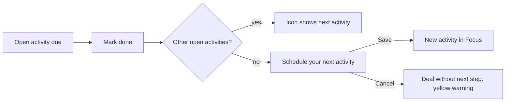

# FL-001 Complete an activity and schedule the next one
User goal: finish today's task and keep the deal moving · Features: F-003, F-004 · Status: done

## Steps

| # | Screen | User action | System response | Evidence |
|---|---|---|---|---|
| 1 | S-001 | Click the green or red status icon on a card | Popover lists the open activities | [obs EV-019] |
| 2 | S-001 | Click the done circle of the only open activity | Toast "Activity marked as done (subject)"; modal skeleton | [obs EV-021] |
| 3 | S-001 | Wait | "Schedule your next activity" with deal and organization linked, first type, today, Free, day agenda | [obs EV-022] |
| 4 | S-001 | Click the start time | Next 15-minute slot filled; Busy | [obs EV-023] |
| 5 | S-002 | Type a subject and Save | "Activity added · View"; activity in Focus | [obs EV-030] |

## Branches and errors

| At step | Condition | What happens | Evidence |
|---|---|---|---|
| 2 | The deal has other open activities | No modal; the icon shows the next one | [obs EV-020] |
| 3 | User clicks Cancel | Nothing saved; card shows the yellow warning; Focus empty state | [obs EV-024] [obs EV-058] |
| 1 | Done from the deal page Focus block | Same modal | [obs EV-030] |

## Diagram

## Not tested

- From the Activities list or calendar; with a person linked (participants); with guests.
