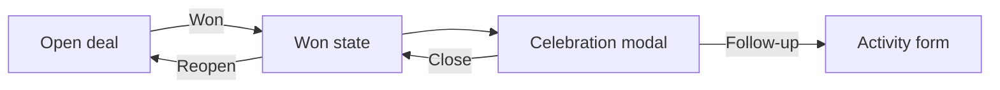

# FL-002 Win a deal
User goal: record a closed sale and plan the next touchpoint · Features: F-005 · Status: done

## Steps

| # | Screen | User action | System response | Evidence |
|---|---|---|---|---|
| 1 | S-002 | Click Won | Status won: WON badge, Reopen, light green stage bar, Won time | [obs EV-035] |
| 2 | S-002 | Wait about 4 seconds | Celebration modal with close time, activities done and "What's next for this won deal?" | [obs EV-034] |
| 3 | S-002 | Choose "Schedule follow-up activity" | "Schedule an activity" form with the won context box, today and the first type | [obs EV-036] |
| 4 | S-002 | Cancel or Save | Back to the won deal; open activities remain open | [obs EV-035] |

## Branches and errors

| At step | Condition | What happens | Evidence |
|---|---|---|---|
| 2 | Choose "Create a project" | not tested | none |
| 1 | Later, click Reopen | Deal open again | [obs EV-037] |

## Diagram

## Not tested

- Won from the board drop zone or the Won dropdown ("Mark as won and create a project" [doc SRC-013]).
