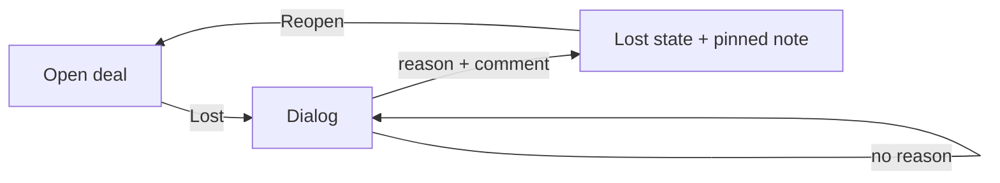

# FL-003 Lose a deal
User goal: close a deal as lost and keep the reason · Features: F-006 · Status: done

## Steps

| # | Screen | User action | System response | Evidence |
|---|---|---|---|---|
| 1 | S-002 | Click Lost | Mark as Lost dialog | [obs EV-038] |
| 2 | S-002 | Click "Mark as lost" without a reason | Red border on the reason; nothing sent | [obs EV-039] |
| 3 | S-002 | Open the reason list and pick a reason | Searchable list of company reasons | [obs EV-040] |
| 4 | S-002 | Type a comment and confirm | Status lost with the reason; comment saved as a pinned note; LOST badge and Reopen | [obs EV-042] |

## Branches and errors

| At step | Condition | What happens | Evidence |
|---|---|---|---|
| 3 | Typed text matches no reason | No option to use it; Enter does nothing | [obs EV-041] |

## Diagram

## Not tested

- Lost from the board drop zone; reopening a lost deal (tested on a won deal only).
