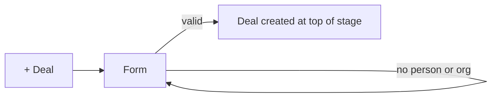

# FL-004 Create a deal from the board
User goal: add a new opportunity to a stage · Features: F-007 · Status: done

## Steps

| # | Screen | User action | System response | Evidence |
|---|---|---|---|---|
| 1 | S-001 | Click "+ Deal" | Add deal form, contact person focused, current pipeline and first stage | [obs EV-049] |
| 2 | S-001 | Type a title and Save | "A person or organization is required" on both fields | [obs EV-050] |
| 3 | S-001 | Type an organization name | Suggestions; NEW badge while unmatched | [obs EV-051] |
| 4 | S-001 | Pick the existing organization, set Visible to, Save | Toast with View; card on top of the stage with NEW | [obs EV-052] [obs EV-053] |

## Branches and errors

| At step | Condition | What happens | Evidence |
|---|---|---|---|
| 3 | User saves with unmatched text | A new organization would be created | [obs EV-051] |

## Diagram

## Not tested

- Creating a person in the form; the "+" in a stage column; the quick add shortcut D.
