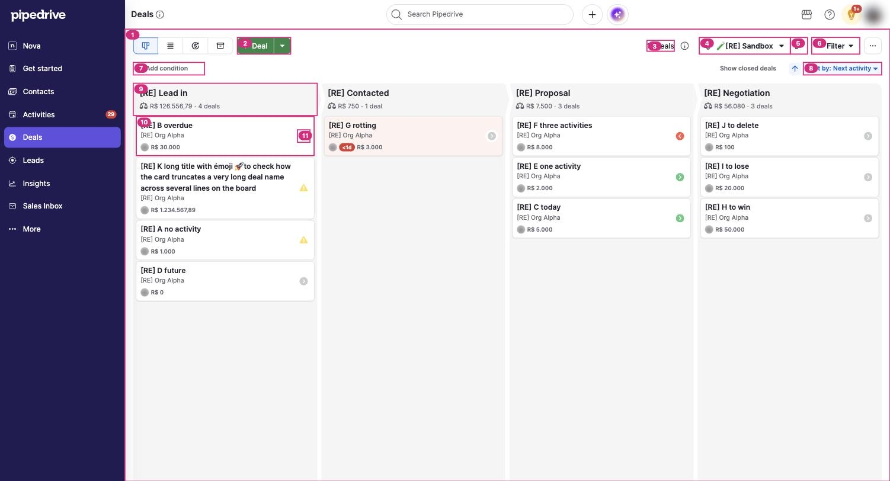

# S-001 Pipeline board
Features: F-001, F-003, F-004, F-007, F-011, F-012 · URL: `/pipeline/:id/user/everyone` · Status: done

## Purpose

The seller's daily work queue. One column per stage of the selected pipeline, one card per open deal, and on each card an icon that says whether the deal has a next step and when it is due. The default order puts what needs action today at the top of every column.

## Entry points

- Sidebar > Deals. `/deals-default` redirects to the last viewed pipeline [obs EV-001].
- The pipeline selector in the toolbar switches pipelines [obs EV-011].

## Anatomy

| # | Region | Contents | Component | Evidence |
|---|---|---|---|---|
| 1 | Board view | Toolbar, quick-filter bar and stage columns | none | [obs EV-011] |
| 2 | Add deal split button | "+ Deal" opens the Add deal form; the arrow opens more create options | C-007 | [obs EV-011] [obs EV-049] |
| 3 | Deal count | "N deals" with an info icon whose tooltip is "Show deals total value" | none | [obs EV-017] |
| 4 | Pipeline selector | Pipeline name with menu: other pipelines, Reorder pipelines, Pipeline visibility, Customize deal cards, Pipeline layout settings, New pipeline | none | [obs EV-011] |
| 5 | Edit pipeline | Pencil button that opens the pipeline editor (S-003) | none | [obs EV-011] |
| 6 | Filter | Saved filters and users | none | [obs EV-011] |
| 7 | Quick filter bar | "Add condition" | none | [obs EV-011] |
| 8 | Sort | Direction arrow and "Sort by: Next activity" menu; "Show closed deals" link to its left | none | [obs EV-026] |
| 9 | Stage header | Stage name, weighted value total (balance icon), deal count; chevron shape between columns | none | [obs EV-010] |
| 10 | Deal card | Title, organization or person, owner avatar, value, rotting badge | C-001 | [obs EV-010] |
| 11 | Activity status icon | One of four states; click opens a popover | C-002 | [obs EV-012] |

View switcher (left of "+ Deal"): board, list, forecast and archive icons [obs EV-011].

## Data shown

| Element | Entity.field | Evidence |
|---|---|---|
| Card title | E-001 Deal.title | [obs EV-010] |
| Card second line | E-005 Organization.name (or the person's name) | [obs EV-010] |
| Card value | E-001 Deal.value and currency, formatted `R$ 1.234.567,89` | [obs EV-010] |
| Activity status icon | earliest open E-002 Activity of the deal (due_date, due_time) | [obs EV-010] [net EV-025] |
| Rotting badge "<1d" | E-004 Stage.days_to_rotten against time in stage | [obs EV-016] |
| Stage header total | Σ Deal.value × Stage.deal_probability ÷ 100 | [obs EV-010] |
| Deal count | open deals in the pipeline | [obs EV-053] |

## States

| State | How to reach it | What it shows | Evidence |
|---|---|---|---|
| Empty | Pipeline or stage with no deals | Empty column with header "R$ 0"; "+" appears on column hover | [obs EV-010] |
| Loading | Open the board | Toolbar first, cards after; the pipeline selector fills in last | [obs EV-001] |
| Typical | Sandbox pipeline with 11 deals | Mixed icons and values | [obs EV-010] |
| Many items | not reached | not tested (production volume seen only in counts) | none |
| Long text | Title of 120 characters with emoji | Wraps to three lines; no truncation | [obs EV-010] |
| Error | none seen | not tested | none |
| No permission | none | not tested (needs a second user) | none |
| Plan-gated | none on this screen | none | none |
| Rotting | Stage with rotting 0 days | Pink card and red "<1d" badge | [obs EV-016] |
| New deal | Save the Add deal form | Card at the top of the stage with a NEW badge until reload | [obs EV-053] |

## Interactions

| Trigger | Result | Request | Persistence scope | Evidence |
|---|---|---|---|---|
| Hover a status icon | Tooltip: "View overdue activity", "View activity scheduled for today", "View upcoming activity" or "Schedule an activity" | none | none | [obs EV-012] [obs EV-013] [obs EV-014] [obs EV-015] |
| Click a status icon | Popover with open activities or "You have no activities scheduled for this deal" | `GET /api/v1/deals/:id/activities` | none | [obs EV-018] [obs EV-019] [net EV-025] |
| Click a done circle in the popover | Activity done; toast; maybe the next-activity modal | `PUT /api/v1/activities/:id` | account | [obs EV-020] [obs EV-022] [net EV-025] |
| Drag a card | Four drop zones appear at the bottom: Delete, Lost, Won, Move to | none seen (drop not completed) | none | [obs EV-054] |
| Open the sort menu | 14 options, "Next activity (default)" checked | none | user (not changed) | [obs EV-026] |
| Click "+ Deal" | Add deal form | see C-007 | none | [obs EV-049] |
| Pipeline selector > New pipeline | Pipeline editor with defaults | none until save | company | [obs EV-003] |

## Keyboard and accessibility

| Check | Result | Evidence |
|---|---|---|
| Tab order | not tested | none |
| Arrow keys | not tested | none |
| Shortcuts | Quick add "+" with one-key shortcuts (C-007 for deals) | [obs EV-055] [doc SRC-016] |
| Focus visible | not tested | none |
| Escape | Closes popovers and menus | [obs EV-019] |
| Unlabeled controls | Several ghost buttons and the modal backdrops have no accessible name | [obs EV-001] |

## Microcopy

| Element | Text | Evidence |
|---|---|---|
| Overdue icon tooltip | View overdue activity | [obs EV-012] |
| No-activity icon tooltip | Schedule an activity | [obs EV-013] |
| Future icon tooltip | View upcoming activity | [obs EV-014] |
| Today icon tooltip | View activity scheduled for today | [obs EV-015] |
| Rotting badge tooltip | No actions for <1 days | [obs EV-016] |
| No-activity popover | You have no activities scheduled for this deal / + Schedule an activity | [obs EV-018] |
| Done toast | Activity marked as done (subject) | [obs EV-020] |
| Create toast | New deal "title" created · View | [obs EV-053] |

## Rules

- R-001, R-002, R-003, R-004, R-005, R-006, R-007, R-008, R-009, R-010, R-011, R-012 (rules/board.md)
- R-013, R-014, R-015 (rules/activities.md)

## Realtime and performance

| Check | Result | Evidence |
|---|---|---|
| A change in a second tab appears without reload | not tested | none |
| Loading pattern (skeleton, spinner, optimistic update) | Status icon and order update in place after a popover action; the column order waits for a reload | [obs EV-020] [obs EV-024] |
| Delays the user sees | The next-activity modal shows a skeleton for 2 to 3 seconds | [obs EV-021] |

## Responsive

| Width | Change | Evidence |
|---|---|---|
| 1710 CSS px | Four columns fit without horizontal scroll | [obs EV-010] |
| Other widths | not tested (the user's own window was not resized) | none |

## Not tested

- Completing a drag (move, won, lost, delete): the automated drag showed the drop zones but did not drop.
- Card customization, filters, "Show closed deals" and changing the sort: these persist for the user and were left alone.
- List, forecast and archive views of the pipeline.
- Realtime updates from another user (needs L1 with a second account).
- Widths other than 1710 px.
