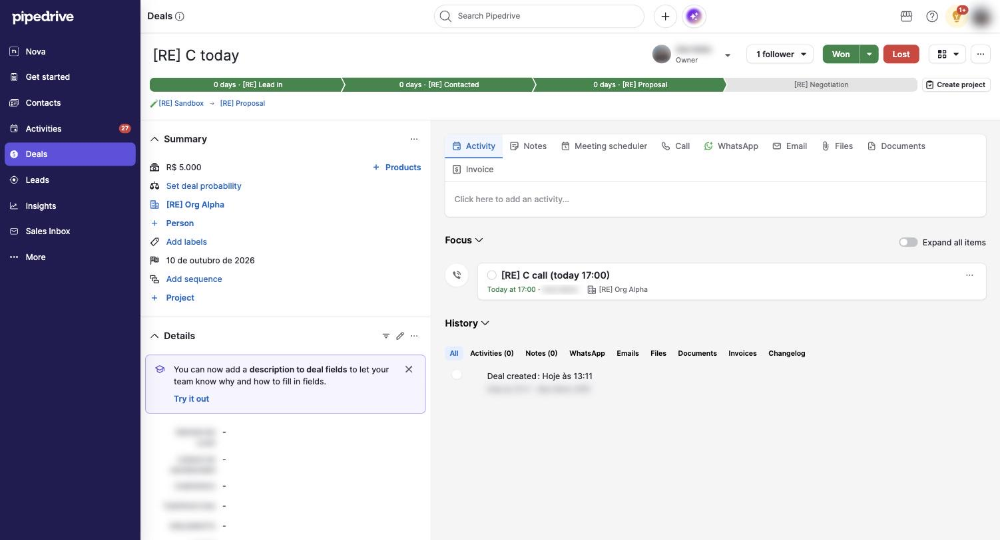

# S-002 Deal detail
Features: F-002, F-003, F-004, F-005, F-006, F-009 · URL: `/deal/:id` · Status: done

## Purpose

Everything about one deal: its stage, its status, its contacts and fields on the left, and on the right the composer, the Focus block (what to do next) and the History timeline. Closing the deal (Won, Lost) and reopening happen here.

## Entry points

- Click a card title on the board [obs EV-010].
- "View" in the toast after creating a deal [obs EV-053].

## Anatomy

| # | Region | Contents | Component | Evidence |
|---|---|---|---|---|
| 1 | Header | Title; owner (avatar, name, "Owner"); followers ("1 follower" menu); Won split button; Lost; layout button; "..." menu | none | [obs EV-027] [obs EV-044] |
| 2 | Stage bar | One chevron per stage with "N days · stage name"; current and past stages green; future grey; "Create project" | C-006 | [obs EV-027] [obs EV-028] [obs EV-029] |
| 3 | Breadcrumb | Pipeline > stage | none | [obs EV-027] |
| 4 | Summary | Value; Products; empty fields as links: "Set deal probability", "+ Person", "Add labels", "Set expected close date", "Add sequence", "+ Project"; organization link; expected close date when set | none | [obs EV-027] [obs EV-038] |
| 5 | Details | Tip banners, then custom fields; after closing: Won time or Lost time and Lost reason | none | [obs EV-035] [obs EV-042] |
| 6 | Composer | Tabs: Activity, Notes, Meeting scheduler, Call, WhatsApp, Email, Files, Documents, Invoice; "Click here to add an activity..." | none | [obs EV-027] |
| 7 | Focus | Open activities (type icon, done circle, subject, relative date, owner, organization, "..." menu) and pinned notes; "Expand all items" toggle | C-003 | [obs EV-027] [obs EV-057] |
| 8 | History | Filters: All, Activities (n), Notes (n), WhatsApp, Emails, Files, Documents, Invoices, Changelog; timeline of done activities, notes and changes | none | [obs EV-030] |

## Data shown

| Element | Entity.field | Evidence |
|---|---|---|
| Stage bar | E-003 Pipeline stages; E-001 Deal.stage_id, stage_change_time | [obs EV-028] [net EV-033] |
| Value | E-001 Deal.value, currency | [obs EV-027] |
| Expected close date | E-001 Deal.expected_close_date, long date format `10 de outubro de 2026` | [obs EV-027] |
| Focus items | open E-002 Activity rows and pinned E-007 Note rows | [obs EV-042] |
| History | done activities, notes, status changes, "Deal created" | [obs EV-030] |
| Won time, Lost time, Lost reason | E-001 Deal.won_time, lost_time, lost_reason | [obs EV-035] [obs EV-042] |

## States

| State | How to reach it | What it shows | Evidence |
|---|---|---|---|
| Empty | Deal with no open activity | Focus: "No focus items yet. Scheduled activities, pinned notes, email drafts and scheduled emails will appear here." and "+ Schedule an activity" | [obs EV-058] |
| Loading | Open the page | Header and sidebar render before Focus | [obs EV-027] |
| Typical | Open deal with one activity | Focus shows it with a relative date | [obs EV-027] |
| Overdue | Open activity due yesterday | Red OVERDUE badge and red "Yesterday at 10:00" | [obs EV-057] |
| Won | Click Won | WON badge, Reopen, light green stage bar, green "Create project", Won time in Details | [obs EV-035] |
| Lost | Mark as lost | LOST badge, Reopen, light red stage bar, Lost time and reason, comment as pinned note | [obs EV-042] |
| Deleted | Delete the deal | Yellow banner with the permanent deletion date; DELETED badge; Restore; grey stage bar; composer locked: "Can't add activities to a deleted deal. Restore the deal to add activities." | [obs EV-046] |
| No permission | not tested | needs a second user | none |
| Plan-gated | none seen | none | none |

## Interactions

| Trigger | Result | Request | Persistence scope | Evidence |
|---|---|---|---|---|
| Click a later stage in the stage bar | Deal moves at once; "Recommended first automation" banner may appear | `GET .../missingRequiredFields`, `PUT /api/v1/deals/:id` | company | [obs EV-032] [net EV-033] |
| Hover a stage | "Stage · Been here for N minutes" or "This deal has not been in this stage yet" | none | none | [obs EV-028] [obs EV-029] |
| Click the done circle in Focus | Activity done; prompt if it was the last open one | `PUT /api/v1/activities/:id` | company | [obs EV-030] [net EV-031] |
| Click Won | Status won; celebration modal after about 4 seconds | `PUT /api/v1/deals/:id` | company | [obs EV-034] [obs EV-035] |
| Click Lost | Mark as Lost dialog | see C-005 | company | [obs EV-038] |
| Click Reopen | Status open again, at once | `PUT /api/v1/deals/:id` with `status` | company | [obs EV-037] [net EV-063] |
| "..." menu | Duplicate, Merge, Export as XLSX, Convert to a lead, Report inaccurate details, Archive (NEW), Delete, Manage sidebar sections | none | none | [obs EV-044] |
| "..." > Delete | Confirmation, then the deleted state | `DELETE /api/v1/deals/:id` | company, 30-day restore | [obs EV-045] [net EV-047] |
| Focus item "..." | Edit, Mark as done, Export as ICS, Delete | none | none | [obs EV-048] |
| Followers menu | The followers (operator only), "Add a follower", "Stop following" | none | none | [obs EV-027] |

## Keyboard and accessibility

| Check | Result | Evidence |
|---|---|---|
| Tab order | not tested | none |
| Arrow keys | not tested | none |
| Shortcuts | none tested | none |
| Focus visible | The "..." button shows a focus ring after a click | [obs EV-058] |
| Escape | Closes menus and the followers list | [obs EV-044] |
| Unlabeled controls | Item menus are labeled "More actions" | [net EV-025] |

## Microcopy

| Element | Text | Evidence |
|---|---|---|
| Focus empty state | No focus items yet. Scheduled activities, pinned notes, email drafts and scheduled emails will appear here. | [obs EV-058] |
| Current stage tooltip | Been here for 10 minutes | [obs EV-028] |
| Future stage tooltip | This deal has not been in this stage yet | [obs EV-029] |
| Automation banner | Recommended first automation · Automatically add an activity when deals reach this stage | [obs EV-032] |
| Deleted banner | Your deal will be deleted permanently after (date). If needed, export the data before that. | [obs EV-046] |
| Locked composer | Can't add activities to a deleted deal. Restore the deal to add activities. | [obs EV-046] |

## Rules

- R-016, R-017, R-018, R-019, R-020, R-021 (rules/activities.md)
- R-022 to R-036 (rules/deal-lifecycle.md)

## Realtime and performance

| Check | Result | Evidence |
|---|---|---|
| A change in a second tab appears without reload | not tested | none |
| Loading pattern (skeleton, spinner, optimistic update) | Focus and History update in place after an action; the "Notes (n)" counter stayed at 1 after deleting the note until reload | [obs EV-042] |
| Delays the user sees | The won modal appears about 4 seconds after the click, after two report calls | [obs EV-034] |

## Responsive

| Width | Change | Evidence |
|---|---|---|
| 1710 CSS px | Two columns (sidebar about one third) | [obs EV-027] |
| Other widths | not tested | none |

## Not tested

- Composer tabs other than Activity (notes would create records; email and WhatsApp reach people).
- Changelog tab, products, labels, sequences, projects and the layout switcher.
- Editing fields inline in Summary and Details.
- Adding a follower or a person (reaches or involves real people).
- Restore from the deleted state.
