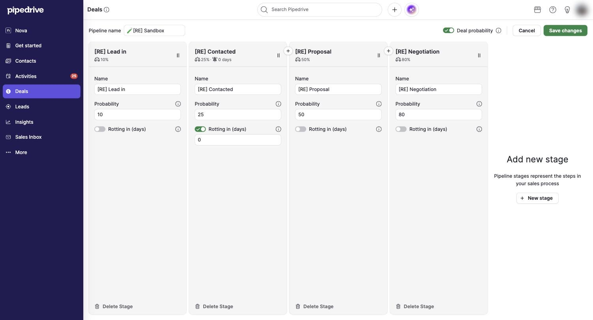

# S-003 Pipeline editor
Features: F-008, F-009 · URL: `/pipeline/:id/add` (new), `/pipeline/:id/edit` (existing) · Status: done

## Purpose

Create or change a pipeline in place, on top of the board: its name, whether deal-level probability is allowed, and per stage the name, the win probability and the rotting period. Deleting a pipeline or a stage starts here.

## Entry points

- Pipeline selector > "+ New pipeline" opens a new pipeline with default stages [obs EV-003].
- The pencil button on the board opens the current pipeline [obs EV-011].

## Anatomy

| # | Region | Contents | Component | Evidence |
|---|---|---|---|---|
| 1 | Top bar | "Pipeline name" input; "Deal probability" toggle with info tooltip; Cancel; Save changes; "..." menu (Duplicate pipeline, Delete pipeline) on an existing pipeline | none | [obs EV-008] [obs EV-004] |
| 2 | Stage column | Header with name, probability and rotting summary ("25% · 0 days"); drag handle; Name; Probability with tooltip; "Rotting in (days)" toggle and number; "Delete Stage" at the bottom | none | [obs EV-008] [obs EV-005] [obs EV-006] |
| 3 | Insert buttons | "+" between columns to add a stage there | none | [obs EV-003] |
| 4 | Add new stage | Right panel: "Pipeline stages represent the steps in your sales process" and "+ New stage" | none | [obs EV-008] |

## Data shown

| Element | Entity.field | Evidence |
|---|---|---|
| Pipeline name | E-003 Pipeline.name | [net EV-009] |
| Deal probability toggle | E-003 Pipeline.is_deal_probability_enabled | [net EV-009] |
| Stage name, probability | E-004 Stage.name, deal_probability | [net EV-009] |
| Rotting | E-004 Stage.is_deal_rot_enabled, days_to_rotten | [net EV-009] |

## States

| State | How to reach it | What it shows | Evidence |
|---|---|---|---|
| Empty | New pipeline | Name "New pipeline"; five stages Qualified, Contact Made, Demo Scheduled, Proposal Made, Negotiations Started, each 100%, rotting off; deal probability on | [obs EV-003] |
| Loading | none seen | none | none |
| Typical | Filled sandbox | Four stages 10/25/50/80%, rotting 0 days on one | [obs EV-008] |
| Many items | not tested | none | none |
| Long text | not tested | none | none |
| Error | not tested (empty name, probability over 100) | none | none |
| No permission | not tested (only deal admins can edit pipelines per the docs) | none | [doc SRC-004] |
| Plan-gated | none | none | none |

## Interactions

| Trigger | Result | Request | Persistence scope | Evidence |
|---|---|---|---|---|
| Turn rotting on | A number field appears with 0; header shows "🔔 0 days" | none until save | company | [obs EV-008] |
| Delete Stage on an empty stage | Dialog "Delete (stage) stage · There are no deals in this stage right now." Cancel / Delete stage | none until save | company | [obs EV-007] |
| Save changes on a new pipeline | Pipeline created; the board returns to the pipeline viewed before | not captured | company | [inf] Q-004 |
| "..." > Delete pipeline | Dialog asks what to do with the N deals; see C-008 | not captured | company | [obs EV-060] [obs EV-061] |

## Keyboard and accessibility

| Check | Result | Evidence |
|---|---|---|
| Tab order | not tested | none |
| Arrow keys | not tested | none |
| Shortcuts | none | none |
| Focus visible | Inputs show a blue focus ring | [obs EV-003] |
| Escape | not tested | none |
| Unlabeled controls | not checked | none |

## Microcopy

| Element | Text | Evidence |
|---|---|---|
| Deal probability tooltip | When enabled in a chosen pipeline, you'll be able to configure individual Deal probability. This type of probability overrides stage probability... | [obs EV-004] |
| Stage probability tooltip | This represents your confidence in winning a deal by the expected close date... The default probability for each stage is 100%... | [obs EV-005] |
| Rotting tooltip | Rotting feature · Deal rotting alerts you to inactive deals by coloring them red. Set the rotting period here. | [obs EV-006] |

## Rules

- R-041, R-042, R-043 (rules/pipeline-editor.md)
- R-035 (rules/deal-lifecycle.md)

## Realtime and performance

| Check | Result | Evidence |
|---|---|---|
| A change in a second tab appears without reload | not tested | none |
| Loading pattern (skeleton, spinner, optimistic update) | The editor replaces the board in place | [obs EV-003] |
| Delays the user sees | none noticed | none |

## Responsive

| Width | Change | Evidence |
|---|---|---|
| 1710 CSS px | Four stage columns and the add panel fit | [obs EV-008] |

## Not tested

- Reordering stages by drag, inserting a stage with "+", duplicating a pipeline.
- Validation of empty names and out-of-range probabilities.
- Deleting a stage that has deals (the docs say its deals are deleted).
- Pipeline visibility settings (company configuration, A4).
