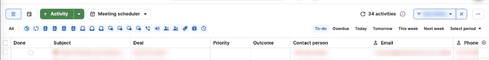

# S-004 Activities list
Features: F-010 · URL: `/activities/list/user/:id` · Status: draft

## Purpose

A table of the user's activities across deals, filtered by period and type. Only the toolbar was studied: the rows are the team's real work.

## Entry points

- Sidebar > Activities (the badge counts the user's overdue and due-today activities) [obs EV-010] [obs EV-056].

## Anatomy

| # | Region | Contents | Component | Evidence |
|---|---|---|---|---|
| 1 | View switch | List and calendar icons | none | [obs EV-056] |
| 2 | Create | "+ Activity" split button; "Meeting scheduler" menu | C-003 | [obs EV-056] |
| 3 | Count | Refresh icon, "N activities", info icon | none | [obs EV-056] |
| 4 | Owner filter | Filter chip with the current user and a clear button | none | [obs EV-056] |
| 5 | Type filter | "All" and one icon per active activity type | none | [obs EV-056] |
| 6 | Period tabs | To-do (selected by default), Overdue, Today, Tomorrow, This week, Next week, Select period | none | [obs EV-056] |
| 7 | Table | Columns Done, Subject, Deal, Priority, Outcome, Contact person, Email, Phone; overdue subjects in red | none | [obs EV-056] |

## Data shown

| Element | Entity.field | Evidence |
|---|---|---|
| Rows | E-002 Activity with linked E-001 Deal and person | [obs EV-056] |

## States

| State | How to reach it | What it shows | Evidence |
|---|---|---|---|
| Empty | not tested | none | none |
| Loading | not tested | none | none |
| Typical | To-do tab | Rows with overdue subjects in red | [obs EV-056] |
| Many items | not tested | none | none |
| Long text | not tested | none | none |
| Error | not tested | none | none |
| No permission | not tested | none | none |
| Plan-gated | none | none | none |

## Interactions

| Trigger | Result | Request | Persistence scope | Evidence |
|---|---|---|---|---|
| Any | not tested (rows are production data) | none | none | none |

## Keyboard and accessibility

| Check | Result | Evidence |
|---|---|---|
| Tab order | not tested | none |
| Arrow keys | not tested | none |
| Shortcuts | not tested | none |
| Focus visible | not tested | none |
| Escape | not tested | none |
| Unlabeled controls | not tested | none |

## Microcopy

| Element | Text | Evidence |
|---|---|---|
| Period tabs | To-do, Overdue, Today, Tomorrow, This week, Next week, Select period | [obs EV-056] |

## Rules

- R-047 (rules/activities.md)

## Realtime and performance

| Check | Result | Evidence |
|---|---|---|
| A change in a second tab appears without reload | not tested | none |
| Loading pattern (skeleton, spinner, optimistic update) | not tested | none |
| Delays the user sees | not tested | none |

## Responsive

| Width | Change | Evidence |
|---|---|---|
| any | not tested | none |

## Not tested

- Everything beyond the toolbar: rows show the team's real activities, so the study stayed on the sandbox deal pages.
- Calendar view, bulk actions, inline done, column settings.
